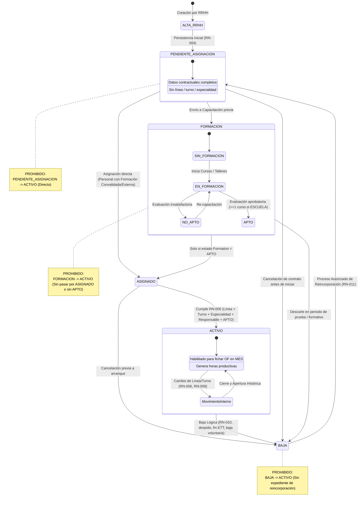
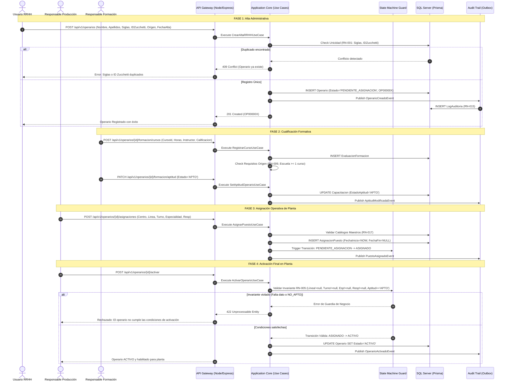
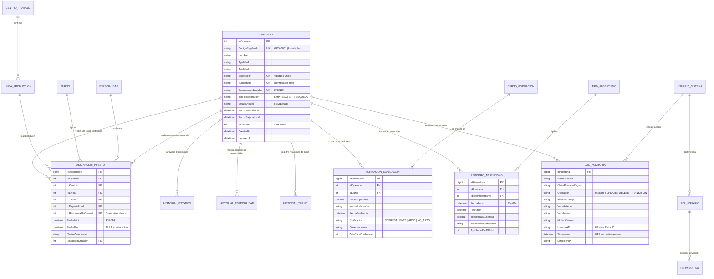

# ARQUITECTURA DE SOFTWARE Y DISEÑO TÉCNICO EMPRESARIAL
## SISTEMA DE GESTIÓN INTEGRAL DE PERSONAL DE FABRICACIÓN (SGP-F)
**Reemplazo Integral de Libro Excel Operativo y Gobierno de Ciclo de Vida**

---

### DOCUMENT CONTROL & METADATA
- **Documento:** Especificación Arquitectónica y Diseño de Dominio (DDD)
- **Versión:** 1.0.0-PROD
- **Estado:** Aprobado para Construcción
- **Autor:** Arquitecto de Software Senior & Especialista en Sistemas Industriales (MES/MOM/HRIS)
- **Ámbito:** Planta de Fabricación / Entorno Industrial
- **Normativas Aplicables:** ISA-95 (Integración Empresa-Control), ISO 27001, RGPD/LOPD-GDD

---

## ÍNDICE GENERAL

1. [Visión General y Justificación Arquitectónica](#1-visión-general-y-justificación-arquitectónica)
2. [Modelo de Dominio (DDD) y Bounded Contexts](#2-modelo-de-dominio-ddd-y-bounded-contexts)
3. [Diagramas UML del Dominio y Ciclo de Vida](#3-diagramas-uml-del-dominio-y-ciclo-de-vida)
4. [Modelo Entidad-Relación (ERD) e Integridad Referencial](#4-modelo-entidad-relación-erd-e-integridad-referencial)
5. [Diseño Físico de Base de Datos SQL Server & Prisma Schema](#5-diseño-físico-de-base-de-datos-sql-server--prisma-schema)
6. [Diseño de API RESTful y Contratos de Servicio](#6-diseño-de-api-restful-y-contratos-de-servicio)
7. [Estructura del Proyecto Backend (Node.js + Express + Clean Architecture)](#7-estructura-del-proyecto-backend-nodejs--express--clean-architecture)
8. [Estructura del Proyecto Frontend (React + Vite + TypeScript + Material UI)](#8-estructura-del-proyecto-frontend-react--vite--typescript--material-ui)
9. [Estrategia de Autenticación y Autorización (Entra ID / Active Directory)](#9-estrategia-de-autenticación-y-autorización-entra-id--active-directory)
10. [Matriz de Control de Acceso (RBAC / ABAC)](#10-matriz-de-control-de-acceso-rbac--abac)
11. [Wireframes Funcionales de Alta Fidelidad (UI/UX)](#11-wireframes-funcionales-de-alta-fidelidad-uiux)
12. [Casos de Uso del Sistema](#12-casos-de-uso-del-sistema)
13. [Historias de Usuario con Criterios de Aceptación Gherkin](#13-historias-de-usuario-con-criterios-de-aceptación-gherkin)
14. [Backlog Inicial del Producto (Priorización MoSCoW)](#14-backlog-inicial-del-producto-priorización-moscow)
15. [Roadmap de Implementación por Fases](#15-roadmap-de-implementación-por-fases)
16. [Estrategia de Auditoría y Trazabilidad (Event-Driven Audit Trail)](#16-estrategia-de-auditoría-y-trazabilidad-event-driven-audit-trail)
17. [Estrategia de Backup, Resiliencia y Disaster Recovery](#17-estrategia-de-backup-resiliencia-y-disaster-recovery)
18. [Estrategia de Despliegue Local e Infraestructura Industrial](#18-estrategia-de-despliegue-local-e-infraestructura-industrial)
19. [Estrategia de Seguridad en Profundidad](#19-estrategia-de-seguridad-en-profundidad)
20. [Plan de Integración Futura (ERP, MES, Zucchetti, Power BI)](#20-plan-de-integración-futura-erp-mes-zucchetti-power-bi)
21. [Registro de Decisiones Arquitectónicas (ADRs)](#21-registro-de-decisiones-arquitectónicas-adrs)

---

## 1. VISIÓN GENERAL Y JUSTIFICACIÓN ARQUITECTÓNICA

### 1.1 El Problema: Patología del "Excel Operativo" en Fábrica
La gestión de operarios en entornos de manufactura a través de hojas de cálculo presenta fallos estructurales que comprometen la continuidad operativa y la trazabilidad legal:
- **Corrupción y desincronización de datos:** Hojas paralelas manipuladas simultáneamente por RRHH, Producción y Formación sin control de concurrencia ni bloqueos de registro.
- **Inconsistencias léxicas:** Múltiples representaciones de un mismo empleado (nombres abreviados, faltas ortográficas, siglas ERP dispares).
- **Inexistencia de auditoría:** Pérdida de autoría en cambios críticos (¿quién movió a un operario de turno?, ¿por qué se activó sin aptitud médica/técnica?).
- **Riesgo en planta y cumplimiento laboral:** Operarios sin formación adecuada operando líneas industriales con riesgo de accidentes o no conformidades de calidad en auditorías IATF 16949 / ISO 9001.

### 1.2 Principios Rectores de la Solución
1. **Modelado de Dominio Rico (DDD):** El modelo de dominio encapsula la lógica de negocio; las entidades no son simples contenedores anémicos de datos, sino que defienden sus propios invariantes (por ejemplo, impidiendo transiciones ilícitas mediante máquinas de estados finitos).
2. **Clean Architecture (Hexagonal / Onion):** Independencia absoluta del framework, de la base de datos y de la interfaz de usuario. Las capas internas (Entidades y Casos de Uso) no conocen a Express, Prisma ni React.
3. **Segregación de Responsabilidades (RN-003):** RRHH y Producción tienen modelos de comando completamente disjuntos. RRHH crea el expediente laboral pero carece de permisos de comando para asignar líneas o puestos. Producción asigna puestos pero carece de potestad contractual.
4. **Trazabilidad Inmutable (Write-Only Audit Log):** Ningún registro que afecte a la asignación, formación, estado o ausencia de un operario se destruye o sobrescribe físicamente.

```
       +-------------------------------------------------------+
       |               FRONTEND (React + MUI)                  |
       +-------------------------------------------------------+
                                  | REST / JSON (Bearer JWT)
                                  v
+---------------------------------------------------------------------+
|                      API GATEWAY / EXPRESS                          |
|  [Auth Middleware: Entra ID]  [RBAC Guard]  [Validation Zod]        |
+---------------------------------------------------------------------+
       |                                           |
       v                                           v
+-----------------------------+     +---------------------------------+
|   APPLICATION CORE (CASOS)  |     |   DOMAIN CORE (REGLAS PURAS)    |
| - CrearAltaRRHHUseCase      |---->| - Aggregate: Operario           |
| - AsignarPuestoUseCase      |     | - FSM: EstadoOperario           |
| - EvaluarFormacionUseCase   |     | - Value Objects: Siglas, IDZucc |
| - RegistrarBajaUseCase      |     | - Domain Events & Invariants    |
+-----------------------------+     +---------------------------------+
       |                                           |
       v                                           v
+---------------------------------------------------------------------+
|                     INFRASTRUCTURE LAYER                            |
| - Repositorios Prisma (SQL Server)                                  |
| - Outbox Pattern / Transactional Audit Logger                       |
| - Adaptador Active Directory / Microsoft Graph                      |
+---------------------------------------------------------------------+
```

---

## 2. MODELO DE DOMINIO (DDD) Y BOUNDED CONTEXTS

El dominio de fabricación se descompone en 5 Bounded Contexts claramente delimitados:

```
+----------------------------------------------------------------------------+
|                         CONTEXT MAP DE LA APLICACIÓN                       |
+----------------------------------------------------------------------------+

  [ BOUNDED CONTEXT: RRHH & IDENTIDAD ]
  - Entidad Raíz: ExpedienteLaboral / Operario
  - Origen: EMPRESA | ETT | ESCUELA
  - Identificador único: OP000001
  - Documentos, Siglas ERP, ID Zucchetti
             |
             | (Domain Event: OperarioCreadoEvent)
             v
  [ BOUNDED CONTEXT: PLANTA & ASIGNACIONES PRODUCTIVAS ] (Producción)
  - Entidad Raíz: AsignacionPuesto (Histórico temporal con vigencia)
  - Catálogos: Centro, Linea, Turno, Especialidad
  - Relación: Responsable (Jerarquía de planta)
             |
             | (Invariante de Activación: RN-005)
             v
  [ BOUNDED CONTEXT: CAPACITACIÓN & CUALIFICACIÓN ] (Formación)
  - Entidad Raíz: ExpedienteFormativo
  - Entidades: Curso, Evaluacion, RegistroHoras
  - Estados: SIN_FORMACION | EN_FORMACION | APTO | NO_APTO
  - Bloqueo MES de fichajes en órdenes de trabajo
             |
             +----------------------------+
             |                            |
             v                            v
  [ BOUNDED CONTEXT: AUSENCIAS ]     [ BOUNDED CONTEXT: AUDITORÍA ]
  - Incidencias temporales           - Registro Inmutable de Eventos
  - IT, Vacaciones, Permisos...       - CDC / Outbox / Change Track
```

### 2.1 Agregados y Raíces de Agregado (Aggregate Roots)
- **Agregado `Operario` (Raíz):**
  - Identificador: `IdentificadorOperario` (VO: `OP000001` - formato inmutable).
  - Atributos: `NombreCompleto` (VO normalizado: Nombre, Apellido1, Apellido2), `SiglasERP` (VO validado), `IdZucchetti` (VO), `TipoIncorporacion` (Enum: `EMPRESA`, `ETT`, `ESCUELA`).
  - Estado: `EstadoOperarioFSM` (`PENDIENTE_ASIGNACION`, `FORMACION`, `ASIGNADO`, `ACTIVO`, `BAJA`).
  - Colección: `HistorialEstados` (Entidades hijas).
  - Reglas de negocio: Defiende que el operario no pase a ACTIVO sin cumplir RN-005.

- **Agregado `AsignacionPuesto` (Raíz):**
  - Identificador: `AsignacionId` (UUID).
  - OperarioId (FK hacia Operario).
  - Componentes: `CentroId`, `LineaId`, `TurnoId`, `EspecialidadId` (MECANICO, ELECTRICO, POLIVALENTE), `ResponsableId`.
  - Temporalidad: `VigenciaTemporal` (FechaInicio, FechaFin nullable).
  - Invariante: Solo puede existir una asignación abierta (`FechaFin IS NULL`) por operario en un instante dado (RN-013).

- **Agregado `CapacitacionOperario` (Raíz):**
  - OperarioId.
  - EstadoAptitud: `SIN_FORMACION`, `EN_FORMACION`, `APTO`, `NO_APTO`.
  - Colección: `ActividadesFormativas` (Curso, Horas, Instructor, Calificación, Fecha).
  - Invariante: Si `TipoIncorporacion == ESCUELA`, debe poseer `ActividadesFormativas.Count >= 1` para optar a `APTO`.

---

## 3. DIAGRAMAS UML DEL DOMINIO Y CICLO DE VIDA

### 3.1 Diagrama de Estados Finito (FSM) del Operario
Representación exhaustiva de las transiciones de estado, condiciones de guardia e interdicciones expresas:



### 3.2 Diagrama de Secuencia: Onboarding e Integración Interdepartamental



---

## 4. MODELO ENTIDAD-RELACIÓN (ERD) E INTEGRIDAD REFERENCIAL

### 4.1 Diagrama Entidad-Relación (Crow's Foot)



---

## 5. DISEÑO FÍSICO DE BASE DE DATOS SQL SERVER & PRISMA SCHEMA

### 5.1 Script DDL SQL Server 2019/2022 (Alineado con Reglas de Negocio)
El diseño físico aplica mecanismos a nivel de motor para garantizar la integridad absoluta:

```sql
-- ============================================================================
-- SCRIPT DE CREACIÓN DDL: SISTEMA DE GESTIÓN DE PERSONAL DE FÁBRICA (SGP-F)
-- MOTOR: Microsoft SQL Server 2019 / 2022 / Azure SQL Database
-- COMPLIANCE: RN-001 a RN-020
-- ============================================================================

CREATE DATABASE SGP_Fabrica COLLATE Modern_Spanish_100_CI_AI_SC_UTF8;
GO

USE SGP_Fabrica;
GO

-- 1. ESQUEMAS
CREATE SCHEMA RRHH;
GO
CREATE SCHEMA Produccion;
GO
CREATE SCHEMA Formacion;
GO
CREATE SCHEMA Seguridad;
GO
CREATE SCHEMA Auditoria;
GO

-- 2. SECUENCIA INMUTABLE PARA IDENTIFICADOR DE OPERARIO (RN-002)
CREATE SEQUENCE RRHH.Seq_Operario_Codigo
    AS INT
    START WITH 1
    INCREMENT BY 1
    NO CYCLE;
GO

-- 3. CATÁLOGOS MAESTROS (RN-017)
CREATE TABLE Produccion.Centros (
    IdCentro INT IDENTITY(1,1) CONSTRAINT PK_Centros PRIMARY KEY,
    CodigoCentro NVARCHAR(20) NOT NULL CONSTRAINT UQ_Centro_Codigo UNIQUE,
    Nombre NVARCHAR(100) NOT NULL,
    Activo BIT NOT NULL CONSTRAINT DF_Centro_Activo DEFAULT 1
);

CREATE TABLE Produccion.Lineas (
    IdLinea INT IDENTITY(1,1) CONSTRAINT PK_Lineas PRIMARY KEY,
    IdCentro INT NOT NULL CONSTRAINT FK_Lineas_Centros REFERENCES Produccion.Centros(IdCentro),
    CodigoLinea NVARCHAR(20) NOT NULL CONSTRAINT UQ_Linea_Codigo UNIQUE, -- L1, L2, L3, L4, L5, BOX
    Nombre NVARCHAR(100) NOT NULL,
    Descripcion NVARCHAR(250) NULL,
    Activo BIT NOT NULL CONSTRAINT DF_Linea_Activo DEFAULT 1,
    CONSTRAINT CK_Lineas_Permitidas 
        CHECK (CodigoLinea IN ('L1', 'L2', 'L3', 'L4', 'L5', 'BOX'))
);

CREATE TABLE Produccion.Turnos (
    IdTurno INT IDENTITY(1,1) CONSTRAINT PK_Turnos PRIMARY KEY,
    CodigoTurno NVARCHAR(20) NOT NULL CONSTRAINT UQ_Turno_Codigo UNIQUE,
    Nombre NVARCHAR(50) NOT NULL, -- MAÑANA (06:00 - 14:00), TARDE (14:00 - 22:00)
    HoraInicio TIME(0) NOT NULL,
    HoraFin TIME(0) NOT NULL,
    Activo BIT NOT NULL CONSTRAINT DF_Turno_Activo DEFAULT 1,
    CONSTRAINT CK_Turnos_Permitidos
        CHECK (CodigoTurno IN ('TURNO_MANANA', 'TURNO_TARDE'))
);

CREATE TABLE Produccion.Especialidades (
    IdEspecialidad INT IDENTITY(1,1) CONSTRAINT PK_Especialidades PRIMARY KEY,
    CodigoEspecialidad NVARCHAR(20) NOT NULL CONSTRAINT UQ_Especialidad_Codigo UNIQUE,
    Nombre NVARCHAR(50) NOT NULL,
    Activo BIT NOT NULL CONSTRAINT DF_Especialidad_Activo DEFAULT 1,
    CONSTRAINT CK_Especialidad_ValoresPermitidos 
        CHECK (CodigoEspecialidad IN ('MECANICO', 'ELECTRICO', 'POLIVALENTE'))
);

-- ASIGNACIÓN PREDETERMINADA FIJADA POR EL JEFE DE FABRICACIÓN
CREATE TABLE Produccion.AsignacionesPredeterminadas (
    IdAsignacionPredeterminada INT IDENTITY(1,1) CONSTRAINT PK_AsigPred PRIMARY KEY,
    IdOperario INT NOT NULL CONSTRAINT FK_AsigPred_Operario REFERENCES RRHH.Operarios(IdOperario),
    IdLineaPredeterminada INT NOT NULL CONSTRAINT FK_AsigPred_Linea REFERENCES Produccion.Lineas(IdLinea),
    IdTurnoPredeterminado INT NOT NULL CONSTRAINT FK_AsigPred_Turno REFERENCES Produccion.Turnos(IdTurno),
    IdJefeFabricacion INT NOT NULL CONSTRAINT FK_AsigPred_Jefe REFERENCES RRHH.Operarios(IdOperario),
    FechaAsignacion DATETIME2(0) NOT NULL CONSTRAINT DF_AsigPred_Fecha DEFAULT SYSUTCDATETIME(),
    Activa BIT NOT NULL CONSTRAINT DF_AsigPred_Activa DEFAULT 1,
    CONSTRAINT UQ_Operario_AsigPred UNIQUE (IdOperario)
);

-- TABLA DE INGESTA POR ARCHIVO CSV DEL MES (ESTRUCTURA EXACTA DE PLANTA)
-- Cruce con el Maestro de Operarios a través de IDOperario (Siglas ERP) y Línea (L1-L5, BOX)
CREATE TABLE Produccion.ImputacionesMES (
    IdImputacion BIGINT IDENTITY(1,1) CONSTRAINT PK_ImputacionesMES PRIMARY KEY,
    NOrden NVARCHAR(30) NOT NULL,          -- Ej: 'OF110337'
    Linea NVARCHAR(10) NOT NULL,           -- Ej: 'L4' (L1, L2, L3, L4, L5, BOX)
    IDOperario NVARCHAR(10) NOT NULL,      -- Siglas ERP (Ej: 'EJAY', 'JMVM', 'SDU' -> FK con RRHH.Operarios.SiglasERP)
    DescOperario NVARCHAR(150) NOT NULL,   -- Ej: 'Acevedo Yuri, Eddy Jonathan'
    DescEstadoOF NVARCHAR(50) NOT NULL,    -- Ej: '50 Iniciada'
    TiempoCierreOF DECIMAL(6,2) NULL,      -- Horas decimales consumidas (Ej: 0.05 = 3 min)
    FechaInicio DATE NOT NULL,             -- Ej: '2026-10-21'
    HoraInicio TIME(0) NOT NULL,           -- Ej: '14:03:00' (T2 - Turno Tarde)
    HoraFin TIME(0) NULL,                  -- Ej: '14:06:00'
    NombreArchivoCSV NVARCHAR(150) NOT NULL, -- Trazabilidad de origen (Ej: 'of_plant_20261021_1500.csv')
    FechaCargaServidor DATETIME2(3) NOT NULL CONSTRAINT DF_ImpMES_Fecha DEFAULT SYSUTCDATETIME(),
    Procesado BIT NOT NULL CONSTRAINT DF_ImpMES_Procesado DEFAULT 0,
    AlertaDiscrepancia NVARCHAR(250) NULL  -- Ej: 'Operario asignado en L1 imputando en L4'
);
GO
CREATE NONCLUSTERED INDEX IX_ImputacionesMES_Siglas_Fecha 
    ON Produccion.ImputacionesMES(IDOperario, FechaInicio);
GO

-- TABLA DE FICHAJES ZUCCHETTI (ESTRUCTURA EXACTA DE LA EXPORTACIÓN DE RELOJ)
CREATE TABLE RRHH.FichajesZucchetti (
    IdFichajeZucchetti BIGINT IDENTITY(1,1) CONSTRAINT PK_FichajesZucchetti PRIMARY KEY,
    Fecha DATE NOT NULL,                   -- Ej: '2026-10-22'
    CodigoEmpresa INT NOT NULL,            -- Ej: 3
    CodigoEmpleado NVARCHAR(30) NOT NULL,  -- Ej: '401437' (FK lógica con RRHH.Operarios.IdZucchetti)
    Nombre NVARCHAR(60) NOT NULL,          -- Ej: 'FRANCISCO JAVIER'
    Apellidos NVARCHAR(100) NOT NULL,      -- Ej: 'ABAD GARCIA'
    CodificacionLibre NVARCHAR(30) NULL,   -- Ej: '3012'
    FichajeEntrada TIME(0) NOT NULL,       -- Ej: '13:51'
    FichajeSalida TIME(0) NULL,            -- Ej: '21:51'
    Turno NVARCHAR(50) NOT NULL,           -- Ej: '13:50-21:50'
    FechaCarga DATETIME2(3) NOT NULL CONSTRAINT DF_Zucc_Fecha DEFAULT SYSUTCDATETIME()
);
GO
CREATE NONCLUSTERED INDEX IX_Zucchetti_Empleado_Fecha 
    ON RRHH.FichajesZucchetti(CodigoEmpleado, Fecha);
GO

-- TABLA DE REGISTRO DE FORMACIÓN STULZ (CONTROL DE ASISTENCIA Y CAPACITACIÓN EN PLANTA)
CREATE TABLE Formacion.RegistrosFormacionPlanta (
    IdRegistroFormacion BIGINT IDENTITY(1,1) CONSTRAINT PK_RegFormacionPlanta PRIMARY KEY,
    Grupo NVARCHAR(50) NOT NULL,           -- Ej: 'Grupo Mecánica Q4'
    Siglas NVARCHAR(10) NOT NULL,          -- Siglas ERP (FK lógica con RRHH.Operarios.SiglasERP)
    NombreApellido NVARCHAR(150) NOT NULL, -- Ej: 'Acevedo Yuri, Eddy Jonathan'
    OFEnCurso NVARCHAR(50) NULL,           -- Ej: 'OF110337'
    Departamento NVARCHAR(80) NOT NULL,    -- Ej: 'Fabricación Clima'
    MaquinaPuesto NVARCHAR(80) NOT NULL,   -- Ej: 'Puesto Ensayos 02'
    Linea NVARCHAR(10) NOT NULL,           -- 'L1', 'L2', 'L3', 'L4', 'L5', 'BOX'
    FechaFormacion DATE NOT NULL,          -- Ej: '2026-10-24'
    Horas DECIMAL(5,2) NOT NULL,           -- Horas dedicadas a la formación
    Turno NVARCHAR(20) NOT NULL,           -- 'TURNO_MANANA' o 'TURNO_TARDE'
    RegistradoPor NVARCHAR(100) NOT NULL,
    CreatedAt DATETIME2(3) NOT NULL CONSTRAINT DF_RegForm_Created DEFAULT SYSUTCDATETIME(),
    CONSTRAINT CK_RegForm_Horas CHECK (Horas >= 0.0 AND Horas <= 12.0)
);
GO

/* ============================================================================
   MAPEO DIRECTO: DEL LIBRO EXCEL HISTÓRICO AL MODELO RELACIONAL SGP-F
   ----------------------------------------------------------------------------
   Columna Excel           -> Campo Base de Datos SGP-F      -> Regla de Negocio
   ----------------------------------------------------------------------------
   1. [ID Operario]        -> RRHH.Operarios.SiglasERP        -> RN-001 (Siglas únicas: 'JMVM', 'SDU')
   2. [DescOperario]       -> Apellido1, Apellido2, Nombre    -> RN-018 (Normalizado: 'VICENTE MARTIN, JUAN MAURICIO')
   3. [Seccion]            -> Produccion.Especialidades.Codigo-> RN-017 (Catálogo cerrado: 'Mecanico')
   4. [Estado]             -> RRHH.Operarios.EstadoActual     -> RN-004, RN-005 ('OK' -> 'ACTIVO')
   5. [Turno]              -> Produccion.Turnos.CodigoTurno   -> 'T1' (06:00-14:00) / 'T2' (14:00-22:00)
   6. [Linea]              -> Produccion.Lineas.CodigoLinea   -> Líneas gemelas ('L1', 'L2', 'L3', 'L4', 'L5', 'BOX')
   7. [Contrato]           -> RRHH.Operarios.TipoIncorporacion-> Inmutable ('Empresa', 'ETT', 'Escuela')
   ============================================================================ */

CREATE TABLE RRHH.TiposAbsentismo (
    IdTipoAbsentismo INT IDENTITY(1,1) CONSTRAINT PK_TiposAbsentismo PRIMARY KEY,
    Codigo NVARCHAR(30) NOT NULL CONSTRAINT UQ_TipoAbsentismo_Codigo UNIQUE,
    Descripcion NVARCHAR(100) NOT NULL,
    EsRemunerado BIT NOT NULL CONSTRAINT DF_TipoAbs_Remunerado DEFAULT 0,
    Activo BIT NOT NULL CONSTRAINT DF_TipoAbs_Activo DEFAULT 1,
    CONSTRAINT CK_TiposAbsentismo_RN012 
        CHECK (Codigo IN ('IT', 'ACCIDENTE', 'VACACIONES', 'PERMISO', 'FORMACION', 'AUSENCIA_INJUSTIFICADA'))
);

-- 4. TABLA PRINCIPAL DE OPERARIOS (RN-001, RN-002, RN-004, RN-010, RN-018)
CREATE TABLE RRHH.Operarios (
    IdOperario INT IDENTITY(1,1) CONSTRAINT PK_Operarios PRIMARY KEY,
    CodigoEmpleado NVARCHAR(10) NOT NULL CONSTRAINT UQ_Operarios_Codigo UNIQUE, -- OP000001
    Nombre NVARCHAR(60) NOT NULL,
    Apellido1 NVARCHAR(60) NOT NULL,
    Apellido2 NVARCHAR(60) NOT NULL,
    SiglasERP NVARCHAR(10) NOT NULL CONSTRAINT UQ_Operarios_Siglas UNIQUE,
    IdZucchetti NVARCHAR(30) NOT NULL CONSTRAINT UQ_Operarios_Zucchetti UNIQUE,
    DocumentoIdentidad NVARCHAR(20) NOT NULL CONSTRAINT UQ_Operarios_DNI UNIQUE,
    TipoIncorporacion NVARCHAR(20) NOT NULL,
    EstadoActual NVARCHAR(30) NOT NULL CONSTRAINT DF_Operarios_Estado DEFAULT 'PENDIENTE_ASIGNACION',
    EstadoFormacion NVARCHAR(30) NOT NULL CONSTRAINT DF_Operarios_Formacion DEFAULT 'SIN_FORMACION',
    FechaAltaLaboral DATE NOT NULL,
    FechaBajaLaboral DATE NULL,
    IsDeleted BIT NOT NULL CONSTRAINT DF_Operarios_SoftDelete DEFAULT 0,
    CreatedAt DATETIME2(3) NOT NULL CONSTRAINT DF_Operarios_CreatedAt DEFAULT SYSUTCDATETIME(),
    UpdatedAt DATETIME2(3) NOT NULL CONSTRAINT DF_Operarios_UpdatedAt DEFAULT SYSUTCDATETIME(),
    
    CONSTRAINT CK_Operarios_TipoIncorporacion 
        CHECK (TipoIncorporacion IN ('EMPRESA', 'ETT', 'ESCUELA')),
    CONSTRAINT CK_Operarios_EstadosPermitidos 
        CHECK (EstadoActual IN ('PENDIENTE_ASIGNACION', 'FORMACION', 'ASIGNADO', 'ACTIVO', 'BAJA')),
    CONSTRAINT CK_Operarios_EstadosFormacion 
        CHECK (EstadoFormacion IN ('SIN_FORMACION', 'EN_FORMACION', 'APTO', 'NO_APTO')),
    CONSTRAINT CK_Operarios_FechasLaborales 
        CHECK (FechaBajaLaboral IS NULL OR FechaBajaLaboral >= FechaAltaLaboral)
);
GO

-- 5. ASIGNACIÓN HISTÓRICA DE PUESTO (RN-006, RN-013, RN-014)
CREATE TABLE Produccion.AsignacionesPuesto (
    IdAsignacion BIGINT IDENTITY(1,1) CONSTRAINT PK_AsignacionesPuesto PRIMARY KEY,
    IdOperario INT NOT NULL CONSTRAINT FK_Asig_Operario REFERENCES RRHH.Operarios(IdOperario),
    IdCentro INT NOT NULL CONSTRAINT FK_Asig_Centro REFERENCES Produccion.Centros(IdCentro),
    IdLinea INT NOT NULL CONSTRAINT FK_Asig_Linea REFERENCES Produccion.Lineas(IdLinea),
    IdTurno INT NOT NULL CONSTRAINT FK_Asig_Turno REFERENCES Produccion.Turnos(IdTurno),
    IdEspecialidad INT NOT NULL CONSTRAINT FK_Asig_Especialidad REFERENCES Produccion.Especialidades(IdEspecialidad),
    IdResponsable INT NOT NULL CONSTRAINT FK_Asig_Responsable REFERENCES RRHH.Operarios(IdOperario),
    FechaInicio DATETIME2(0) NOT NULL,
    FechaFin DATETIME2(0) NULL,
    Motivo NVARCHAR(250) NULL,
    CreadoPor NVARCHAR(100) NOT NULL,
    CreatedAt DATETIME2(3) NOT NULL CONSTRAINT DF_Asig_CreatedAt DEFAULT SYSUTCDATETIME(),
    
    CONSTRAINT CK_Asignaciones_IntegridadTemporal 
        CHECK (FechaFin IS NULL OR FechaFin >= FechaInicio)
);
GO

-- ÍNDICE FILTRADO ÚNICO: GARANTIZA MATEMÁTICAMENTE QUE NO HAYA 2 LÍNEAS ACTIVAS (RN-013)
CREATE UNIQUE NONCLUSTERED INDEX UQ_Operario_Asignacion_Activa
    ON Produccion.AsignacionesPuesto(IdOperario)
    WHERE FechaFin IS NULL;
GO

-- 6. FORMACIÓN Y EVALUACIONES (RN-009)
CREATE TABLE Formacion.Cursos (
    IdCurso INT IDENTITY(1,1) CONSTRAINT PK_Cursos PRIMARY KEY,
    CodigoCurso NVARCHAR(30) NOT NULL CONSTRAINT UQ_Curso_Codigo UNIQUE,
    Titulo NVARCHAR(150) NOT NULL,
    HorasEstimadas DECIMAL(5,2) NOT NULL,
    ContenidoResumido NVARCHAR(500) NULL,
    Activo BIT NOT NULL CONSTRAINT DF_Cursos_Activo DEFAULT 1
);

CREATE TABLE Formacion.Evaluaciones (
    IdEvaluacion BIGINT IDENTITY(1,1) CONSTRAINT PK_Evaluaciones PRIMARY KEY,
    IdOperario INT NOT NULL CONSTRAINT FK_Eval_Operario REFERENCES RRHH.Operarios(IdOperario),
    IdCurso INT NOT NULL CONSTRAINT FK_Eval_Curso REFERENCES Formacion.Cursos(IdCurso),
    Instructor NVARCHAR(120) NOT NULL,
    HorasRealizadas DECIMAL(5,2) NOT NULL,
    FechaEvaluacion DATE NOT NULL,
    Calificacion NVARCHAR(20) NOT NULL, -- APTO, NO_APTO, PENDIENTE
    PuntuacionNumerica DECIMAL(4,2) NULL,
    Observaciones NVARCHAR(500) NULL,
    RegistradoPor NVARCHAR(100) NOT NULL,
    CreatedAt DATETIME2(3) NOT NULL CONSTRAINT DF_Eval_CreatedAt DEFAULT SYSUTCDATETIME(),
    CONSTRAINT CK_Evaluaciones_Calificacion CHECK (Calificacion IN ('APTO', 'NO_APTO', 'PENDIENTE'))
);
GO

-- 7. GESTIÓN COLABORATIVA DE AUSENCIAS Y BAJAS (PRODUCCIÓN & RRHH - RN-012, RN-014)
CREATE TABLE RRHH.RegistrosAbsentismo (
    IdAbsentismo BIGINT IDENTITY(1,1) CONSTRAINT PK_RegistrosAbsentismo PRIMARY KEY,
    IdOperario INT NOT NULL CONSTRAINT FK_Abs_Operario REFERENCES RRHH.Operarios(IdOperario),
    IdTipoAbsentismo INT NOT NULL CONSTRAINT FK_Abs_Tipo REFERENCES RRHH.TiposAbsentismo(IdTipoAbsentismo),
    OrigenRegistro NVARCHAR(30) NOT NULL, -- 'PRODUCCION' (In situ en planta) o 'RRHH' (Parte oficial)
    FechaInicio DATETIME2(0) NOT NULL,
    FechaFin DATETIME2(0) NULL,           -- NULL mientras la baja esté abierta
    FechaFinEstimada DATE NULL,           -- Estimación informada por RRHH con parte médico
    NumeroParteBaja NVARCHAR(50) NULL,    -- Código de baja de la Seguridad Social / Mutua
    HorasTotales DECIMAL(6,2) NULL,
    Observaciones NVARCHAR(300) NULL,
    Aprobado BIT NOT NULL CONSTRAINT DF_Abs_Aprobado DEFAULT 0,
    RegistradoPor NVARCHAR(100) NOT NULL,
    ModificadoPorRRHH NVARCHAR(100) NULL,
    FechaModificacionRRHH DATETIME2(3) NULL,
    CreatedAt DATETIME2(3) NOT NULL CONSTRAINT DF_Abs_CreatedAt DEFAULT SYSUTCDATETIME(),
    CONSTRAINT CK_Absentismo_Fechas CHECK (FechaFin IS NULL OR FechaFin >= FechaInicio)
);
GO

-- NOTIFICACIONES CRUZADAS ENTRE PRODUCCIÓN Y RRHH
CREATE TABLE Seguridad.NotificacionesInternas (
    IdNotificacion BIGINT IDENTITY(1,1) CONSTRAINT PK_Notificaciones PRIMARY KEY,
    TipoNotificacion NVARCHAR(40) NOT NULL, -- 'CAMBIO_LINEA', 'BAJA_REGISTRADA', 'ESTIMACION_BAJA_RRHH', 'AUSENCIA_TURNO'
    IdOperario INT NOT NULL CONSTRAINT FK_Notif_Operario REFERENCES RRHH.Operarios(IdOperario),
    RolEmisor NVARCHAR(30) NOT NULL,       -- 'PRODUCCION' o 'RRHH'
    RolDestino NVARCHAR(30) NOT NULL,      -- 'RRHH' o 'PRODUCCION'
    Titulo NVARCHAR(100) NOT NULL,
    Mensaje NVARCHAR(500) NOT NULL,
    FechaEmision DATETIME2(3) NOT NULL CONSTRAINT DF_Notif_Fecha DEFAULT SYSUTCDATETIME(),
    Leida BIT NOT NULL CONSTRAINT DF_Notif_Leida DEFAULT 0
);
GO

-- 8. HISTÓRICOS ESPECÍFICOS Y TRANSICIÓN DE ESTADOS (RN-006, RN-007, RN-008, RN-016)
CREATE TABLE RRHH.HistorialEstados (
    IdHistorialEstado BIGINT IDENTITY(1,1) CONSTRAINT PK_HistorialEstados PRIMARY KEY,
    IdOperario INT NOT NULL CONSTRAINT FK_HistEst_Operario REFERENCES RRHH.Operarios(IdOperario),
    EstadoAnterior NVARCHAR(30) NULL,
    EstadoNuevo NVARCHAR(30) NOT NULL,
    FechaTransicion DATETIME2(3) NOT NULL CONSTRAINT DF_HistEst_Fecha DEFAULT SYSUTCDATETIME(),
    Usuario NVARCHAR(100) NOT NULL,
    Motivo NVARCHAR(250) NOT NULL
);

CREATE TABLE Produccion.HistorialEspecialidades (
    IdHistorialEspecialidad BIGINT IDENTITY(1,1) CONSTRAINT PK_HistEspec PRIMARY KEY,
    IdOperario INT NOT NULL CONSTRAINT FK_HistEsp_Operario REFERENCES RRHH.Operarios(IdOperario),
    EspecialidadAnterior NVARCHAR(50) NULL,
    EspecialidadNueva NVARCHAR(50) NOT NULL,
    FechaCambio DATETIME2(3) NOT NULL CONSTRAINT DF_HistEsp_Fecha DEFAULT SYSUTCDATETIME(),
    Usuario NVARCHAR(100) NOT NULL,
    Motivo NVARCHAR(250) NOT NULL
);

CREATE TABLE Produccion.HistorialTurnos (
    IdHistorialTurno BIGINT IDENTITY(1,1) CONSTRAINT PK_HistTurno PRIMARY KEY,
    IdOperario INT NOT NULL CONSTRAINT FK_HistTur_Operario REFERENCES RRHH.Operarios(IdOperario),
    TurnoAnterior NVARCHAR(50) NULL,
    TurnoNuevo NVARCHAR(50) NOT NULL,
    FechaCambio DATETIME2(3) NOT NULL CONSTRAINT DF_HistTur_Fecha DEFAULT SYSUTCDATETIME(),
    Usuario NVARCHAR(100) NOT NULL,
    Motivo NVARCHAR(250) NOT NULL
);
GO

-- 9. TABLA DE AUDITORÍA GLOBAL WRITE-ONLY (RN-015)
CREATE TABLE Auditoria.LogTransaccional (
    IdLog BIGINT IDENTITY(1,1) CONSTRAINT PK_LogTransaccional PRIMARY KEY,
    NombreEsquema NVARCHAR(50) NOT NULL,
    NombreTabla NVARCHAR(50) NOT NULL,
    IdRegistro NVARCHAR(50) NOT NULL,
    Accion NVARCHAR(20) NOT NULL, -- INSERT, UPDATE, SOFT_DELETE
    ColumnaAfectada NVARCHAR(100) NOT NULL,
    ValorAnterior NVARCHAR(MAX) NULL,
    ValorNuevo NVARCHAR(MAX) NULL,
    Usuario NVARCHAR(100) NOT NULL,
    FechaHoraUTC DATETIME2(3) NOT NULL CONSTRAINT DF_Log_Fecha DEFAULT SYSUTCDATETIME(),
    IPCliente NVARCHAR(50) NULL,
    CorrelacionId UNIQUEIDENTIFIER NULL
);
GO

-- SEGURIDAD: PREVENCIÓN DE MODIFICACIÓN O BORRADO DE AUDITORÍA
DENY UPDATE, DELETE ON Auditoria.LogTransaccional TO PUBLIC;
GO

-- 10. VISTA MAESTRA PARA HEADCOUNT EN PLANTA (RN-020)
CREATE OR ALTER VIEW Produccion.vw_HeadcountActivo
AS
SELECT 
    c.Nombre AS Centro,
    l.Nombre AS Linea,
    t.Nombre AS Turno,
    e.Nombre AS Especialidad,
    COUNT(o.IdOperario) AS TotalOperariosActivos
FROM RRHH.Operarios o
INNER JOIN Produccion.AsignacionesPuesto ap 
    ON o.IdOperario = ap.IdOperario 
    AND ap.FechaFin IS NULL
INNER JOIN Produccion.Centros c ON ap.IdCentro = c.IdCentro
INNER JOIN Produccion.Lineas l ON ap.IdLinea = l.IdLinea
INNER JOIN Produccion.Turnos t ON ap.IdTurno = t.IdTurno
INNER JOIN Produccion.Especialidades e ON ap.IdEspecialidad = e.IdEspecialidad
WHERE o.EstadoActual = 'ACTIVO' 
  AND o.IsDeleted = 0
GROUP BY c.Nombre, l.Nombre, t.Nombre, e.Nombre;
GO
```

### 5.2 Esquema Prisma (`prisma/schema.prisma`)

```prisma
datasource db {
  provider = "sqlserver"
  url      = env("DATABASE_URL")
}

generator client {
  provider = "prisma-client-js"
}

enum TipoIncorporacion {
  EMPRESA
  ETT
  ESCUELA
}

enum EstadoOperario {
  PENDIENTE_ASIGNACION
  FORMACION
  ASIGNADO
  ACTIVO
  BAJA
}

enum EstadoFormacion {
  SIN_FORMACION
  EN_FORMACION
  APTO
  NO_APTO
}

enum EspecialidadTipo {
  MECANICO
  ELECTRICO
  POLIVALENTE
}

enum TipoAbsentismoEnum {
  IT
  ACCIDENTE
  VACACIONES
  PERMISO
  FORMACION
  AUSENCIA_INJUSTIFICADA
}

model Operario {
  idOperario          Int                  @id @default(autoincrement()) @map("IdOperario")
  codigoEmpleado      String               @unique @map("CodigoEmpleado") @db.NVarChar(10)
  nombre              String               @map("Nombre") @db.NVarChar(60)
  apellido1           String               @map("Apellido1") @db.NVarChar(60)
  apellido2           String               @map("Apellido2") @db.NVarChar(60)
  siglasERP           String               @unique @map("SiglasERP") @db.NVarChar(10)
  idZucchetti         String               @unique @map("IdZucchetti") @db.NVarChar(30)
  documentoIdentidad  String               @unique @map("DocumentoIdentidad") @db.NVarChar(20)
  tipoIncorporacion   TipoIncorporacion    @map("TipoIncorporacion")
  estadoActual        EstadoOperario       @default(PENDIENTE_ASIGNACION) @map("EstadoActual")
  estadoFormacion     EstadoFormacion      @default(SIN_FORMACION) @map("EstadoFormacion")
  fechaAltaLaboral    DateTime             @map("FechaAltaLaboral") @db.Date
  fechaBajaLaboral    DateTime?            @map("FechaBajaLaboral") @db.Date
  isDeleted           Boolean              @default(false) @map("IsDeleted")
  createdAt           DateTime             @default(now()) @map("CreatedAt")
  updatedAt           DateTime             @updatedAt @map("UpdatedAt")

  asignaciones        AsignacionPuesto[]   @relation("OperarioAsignado")
  supervisiones       AsignacionPuesto[]   @relation("ResponsableAsignacion")
  evaluaciones        EvaluacionFormacion[]
  absentismos         RegistroAbsentismo[]
  historialEstados    HistorialEstado[]
  historialEspec      HistorialEspecialidad[]
  historialTurnos     HistorialTurno[]

  @@map("Operarios")
  @@schema("RRHH")
}

model Centro {
  idCentro     Int                @id @default(autoincrement()) @map("IdCentro")
  codigoCentro String             @unique @map("CodigoCentro") @db.NVarChar(20)
  nombre       String             @map("Nombre") @db.NVarChar(100)
  activo       Boolean            @default(true) @map("Activo")
  lineas       Linea[]
  asignaciones AsignacionPuesto[]

  @@map("Centros")
  @@schema("Produccion")
}

model Linea {
  idLinea      Int                @id @default(autoincrement()) @map("IdLinea")
  idCentro     Int                @map("IdCentro")
  codigoLinea  String             @unique @map("CodigoLinea") @db.NVarChar(20)
  nombre       String             @map("Nombre") @db.NVarChar(100)
  descripcion  String?            @map("Descripcion") @db.NVarChar(250)
  activo       Boolean            @default(true) @map("Activo")
  centro       Centro             @relation(fields: [idCentro], references: [idCentro])
  asignaciones AsignacionPuesto[]

  @@map("Lineas")
  @@schema("Produccion")
}

model Turno {
  idTurno      Int                @id @default(autoincrement()) @map("IdTurno")
  codigoTurno  String             @unique @map("CodigoTurno") @db.NVarChar(20)
  nombre       String             @map("Nombre") @db.NVarChar(50)
  horaInicio   DateTime           @map("HoraInicio") @db.Time(0)
  horaFin      DateTime           @map("HoraFin") @db.Time(0)
  activo       Boolean            @default(true) @map("Activo")
  asignaciones AsignacionPuesto[]

  @@map("Turnos")
  @@schema("Produccion")
}

model Especialidad {
  idEspecialidad     Int                @id @default(autoincrement()) @map("IdEspecialidad")
  codigoEspecialidad EspecialidadTipo   @unique @map("CodigoEspecialidad")
  nombre             String             @map("Nombre") @db.NVarChar(50)
  activo             Boolean            @default(true) @map("Activo")
  asignaciones       AsignacionPuesto[]

  @@map("Especialidades")
  @@schema("Produccion")
}

model AsignacionPuesto {
  idAsignacion     BigInt       @id @default(autoincrement()) @map("IdAsignacion")
  idOperario       Int          @map("IdOperario")
  idCentro         Int          @map("IdCentro")
  idLinea          Int          @map("IdLinea")
  idTurno          Int          @map("IdTurno")
  idEspecialidad   Int          @map("IdEspecialidad")
  idResponsable    Int          @map("IdResponsable")
  fechaInicio      DateTime     @map("FechaInicio")
  fechaFin         DateTime?    @map("FechaFin")
  motivo           String?      @map("Motivo") @db.NVarChar(250)
  creadoPor        String       @map("CreadoPor") @db.NVarChar(100)
  createdAt        DateTime     @default(now()) @map("CreatedAt")

  operario         Operario     @relation("OperarioAsignado", fields: [idOperario], references: [idOperario])
  responsable      Operario     @relation("ResponsableAsignacion", fields: [idResponsable], references: [idOperario], onUpdate: NoAction, onDelete: NoAction)
  centro           Centro       @relation(fields: [idCentro], references: [idCentro])
  linea            Linea        @relation(fields: [idLinea], references: [idLinea])
  turno            Turno        @relation(fields: [idTurno], references: [idTurno])
  especialidad     Especialidad @relation(fields: [idEspecialidad], references: [idEspecialidad])

  @@index([idOperario, fechaFin], name: "IX_Asignacion_Vigencia")
  @@map("AsignacionesPuesto")
  @@schema("Produccion")
}

model Curso {
  idCurso         Int                   @id @default(autoincrement()) @map("IdCurso")
  codigoCurso     String                @unique @map("CodigoCurso") @db.NVarChar(30)
  titulo          String                @map("Titulo") @db.NVarChar(150)
  horasEstimadas  Decimal               @map("HorasEstimadas") @db.Decimal(5, 2)
  activo          Boolean               @default(true) @map("Activo")
  evaluaciones    EvaluacionFormacion[]

  @@map("Cursos")
  @@schema("Formacion")
}

model EvaluacionFormacion {
  idEvaluacion       BigInt   @id @default(autoincrement()) @map("IdEvaluacion")
  idOperario         Int      @map("IdOperario")
  idCurso            Int      @map("IdCurso")
  instructor         String   @map("Instructor") @db.NVarChar(120)
  horasRealizadas    Decimal  @map("HorasRealizadas") @db.Decimal(5, 2)
  fechaEvaluacion    DateTime @map("FechaEvaluacion") @db.Date
  calificacion       String   @map("Calificacion") @db.NVarChar(20)
  observaciones      String?  @map("Observaciones") @db.NVarChar(500)
  registradoPor      String   @map("RegistradoPor") @db.NVarChar(100)
  createdAt          DateTime @default(now()) @map("CreatedAt")

  operario           Operario @relation(fields: [idOperario], references: [idOperario])
  curso              Curso    @relation(fields: [idCurso], references: [idCurso])

  @@map("Evaluaciones")
  @@schema("Formacion")
}

model RegistroAbsentismo {
  idAbsentismo    BigInt             @id @default(autoincrement()) @map("IdAbsentismo")
  idOperario      Int                @map("IdOperario")
  tipoAbsentismo  TipoAbsentismoEnum @map("TipoAbsentismo")
  fechaInicio     DateTime           @map("FechaInicio")
  fechaFin        DateTime           @map("FechaFin")
  horasTotales    Decimal            @map("HorasTotales") @db.Decimal(6, 2)
  observaciones   String?            @map("Observaciones") @db.NVarChar(300)
  aprobado        Boolean            @default(false) @map("Aprobado")
  registradoPor   String             @map("RegistradoPor") @db.NVarChar(100)
  createdAt       DateTime           @default(now()) @map("CreatedAt")

  operario        Operario           @relation(fields: [idOperario], references: [idOperario])

  @@map("RegistrosAbsentismo")
  @@schema("RRHH")
}

model HistorialEstado {
  idHistorialEstado BigInt   @id @default(autoincrement()) @map("IdHistorialEstado")
  idOperario        Int      @map("IdOperario")
  estadoAnterior    String?  @map("EstadoAnterior") @db.NVarChar(30)
  estadoNuevo       String   @map("EstadoNuevo") @db.NVarChar(30)
  fechaTransicion   DateTime @default(now()) @map("FechaTransicion")
  usuario           String   @map("Usuario") @db.NVarChar(100)
  motivo            String   @map("Motivo") @db.NVarChar(250)

  operario          Operario @relation(fields: [idOperario], references: [idOperario])

  @@map("HistorialEstados")
  @@schema("RRHH")
}

model HistorialEspecialidad {
  idHistorialEspec     BigInt   @id @default(autoincrement()) @map("IdHistorialEspecialidad")
  idOperario           Int      @map("IdOperario")
  especialidadAnterior String?  @map("EspecialidadAnterior") @db.NVarChar(50)
  especialidadNueva    String   @map("EspecialidadNueva") @db.NVarChar(50)
  fechaCambio          DateTime @default(now()) @map("FechaCambio")
  usuario              String   @map("Usuario") @db.NVarChar(100)
  motivo               String   @map("Motivo") @db.NVarChar(250)

  operario             Operario @relation(fields: [idOperario], references: [idOperario])

  @@map("HistorialEspecialidades")
  @@schema("Produccion")
}

model HistorialTurno {
  idHistorialTurno BigInt   @id @default(autoincrement()) @map("IdHistorialTurno")
  idOperario       Int      @map("IdOperario")
  turnoAnterior    String?  @map("TurnoAnterior") @db.NVarChar(50)
  turnoNuevo       String   @map("TurnoNuevo") @db.NVarChar(50)
  fechaCambio      DateTime @default(now()) @map("FechaCambio")
  usuario          String   @map("Usuario") @db.NVarChar(100)
  motivo           String   @map("Motivo") @db.NVarChar(250)

  operario         Operario @relation(fields: [idOperario], references: [idOperario])

  @@map("HistorialTurnos")
  @@schema("Produccion")
}

model LogAuditoria {
  idLog            BigInt   @id @default(autoincrement()) @map("IdLog")
  nombreEsquema    String   @map("NombreEsquema") @db.NVarChar(50)
  nombreTabla      String   @map("NombreTabla") @db.NVarChar(50)
  idRegistro       String   @map("IdRegistro") @db.NVarChar(50)
  accion           String   @map("Accion") @db.NVarChar(20)
  columnaAfectada  String   @map("ColumnaAfectada") @db.NVarChar(100)
  valorAnterior    String?  @map("ValorAnterior") @db.NVarChar(max)
  valorNuevo       String?  @map("ValorNuevo") @db.NVarChar(max)
  usuario          String   @map("Usuario") @db.NVarChar(100)
  fechaHoraUTC     DateTime @default(now()) @map("FechaHoraUTC")
  ipCliente        String?  @map("IPCliente") @db.NVarChar(50)
  correlacionId    String?  @map("CorrelacionId")

  @@map("LogTransaccional")
  @@schema("Auditoria")
}
```

---

## 6. DISEÑO DE API RESTFUL Y CONTRATOS DE SERVICIO

### 6.1 Matriz de Endpoints por Rol y Bounded Context

| Método | Endpoint | Rol Requerido | Propósito Funcional | Invariantes Aplicados |
| :--- | :--- | :--- | :--- | :--- |
| `POST` | `/api/v1/operarios` | `RRHH`, `ADMIN` | Alta administrativa inicial | RN-001, RN-002, RN-004, RN-018 |
| `GET` | `/api/v1/operarios` | Todos (Filtrado) | Listado paginado y con filtros | RN-019 (Soft delete excluido) |
| `GET` | `/api/v1/operarios/:id` | Todos | Consulta de ficha 360° | Formateo normalizado |
| `POST` | `/api/v1/operarios/:id/asignaciones` | `PRODUCCION`, `ADMIN` | Asignar línea, turno y puesto | RN-003, RN-006, RN-013, RN-017 |
| `PATCH` | `/api/v1/operarios/:id/cambio-turno` | `PRODUCCION`, `ADMIN` | Rotación de turno con motivo | RN-008, RN-013 |
| `PATCH` | `/api/v1/operarios/:id/cambio-especialidad`| `PRODUCCION`, `ADMIN` | Cambio de especialidad | RN-007, RN-017 |
| `POST` | `/api/v1/operarios/:id/activar` | `PRODUCCION`, `ADMIN` | Transición final a ACTIVO | RN-005 (FSM Validation) |
| `POST` | `/api/v1/operarios/:id/formacion/evaluacion`| `FORMACION`, `ADMIN` | Registro de curso y horas | RN-009 |
| `PATCH` | `/api/v1/operarios/:id/formacion/aptitud` | `FORMACION`, `ADMIN` | Dictamen APTO / NO_APTO | Regla Escuela >= 1 curso |
| `POST` | `/api/v1/operarios/:id/absentismo` | `RRHH`, `PRODUCCION`, `ADMIN`| Registro de baja médica/ausencia | RN-012, RN-014 |
| `POST` | `/api/v1/operarios/:id/baja` | `RRHH`, `ADMIN` | Baja lógica de la empresa | RN-010, Cierre de asignaciones |
| `POST` | `/api/v1/operarios/:id/reincorporacion`| `RRHH`, `ADMIN` | Reincorporar ex-operario | RN-011 (Mantiene OP00000X) |
| `GET` | `/api/v1/reportes/headcount` | `DIRECCION`, `ADMIN` | KPI Headcount y distribución | RN-020 |
| `GET` | `/api/v1/auditoria/operarios/:id` | `DIRECCION`, `ADMIN` | Historial inmutable de cambios | RN-015, RN-016 |

### 6.2 Contratos JSON (Payloads & Responses)

#### `POST /api/v1/operarios` (Creación RRHH)
```json
// REQUEST
{
  "nombre": "Carlos",
  "apellido1": "Gómez",
  "apellido2": "Navarro",
  "siglasERP": "CGN",
  "idZucchetti": "ZUC-98442",
  "documentoIdentidad": "48992144B",
  "tipoIncorporacion": "ESCUELA",
  "fechaAltaLaboral": "2026-11-01"
}

// RESPONSE 201 Created
{
  "success": true,
  "data": {
    "idOperario": 142,
    "codigoEmpleado": "OP000142",
    "nombreCompleto": "Carlos Gómez Navarro",
    "estadoActual": "PENDIENTE_ASIGNACION",
    "estadoFormacion": "SIN_FORMACION",
    "createdAt": "2026-10-24T21:00:00.000Z"
  }
}
```

#### `POST /api/v1/operarios/142/asignaciones` (Completar Producción)
```json
// REQUEST
{
  "idCentro": 1,
  "idLinea": 3,
  "idTurno": 2,
  "especialidad": "MECANICO",
  "idResponsable": 12,
  "fechaInicio": "2026-11-02T06:00:00Z",
  "motivo": "Asignación inicial post-onboarding"
}

// RESPONSE 200 OK
{
  "success": true,
  "data": {
    "idAsignacion": 850,
    "operario": "OP000142",
    "linea": "Línea Montaje HVAC 03",
    "turno": "TARDE",
    "especialidad": "MECANICO",
    "responsable": "OP000012 - Juan Martínez",
    "estadoOperario": "ASIGNADO"
  }
}
```

---

## 7. ESTRUCTURA DEL PROYECTO BACKEND (NODE.JS + EXPRESS + CLEAN ARCHITECTURE)

La arquitectura sigue el patrón de capas concéntricas con estricta inversión de dependencias:

```
backend/
├── src/
│   ├── domain/                               # CAPA DE DOMINIO (Reglas puras, Cero dependencias)
│   │   ├── aggregates/
│   │   │   ├── Operario.ts                  # Raíz de Agregado con invariantes
│   │   │   └── AsignacionPuesto.ts
│   │   ├── entities/
│   │   │   ├── EvaluacionFormacion.ts
│   │   │   └── RegistroAbsentismo.ts
│   │   ├── value-objects/
│   │   │   ├── CodigoOperario.ts            # Valida OP000001
│   │   │   ├── NombreNormalizado.ts         # RN-018
│   │   │   ├── SiglasERP.ts
│   │   │   └── VigenciaTemporal.ts          # RN-014
│   │   ├── events/
│   │   │   ├── OperarioCreadoEvent.ts
│   │   │   ├── EstadoOperarioCambiadoEvent.ts
│   │   │   └── PuestoAsignadoEvent.ts
│   │   ├── exceptions/
│   │   │   ├── TransicionInvalidaException.ts
│   │   │   └── InvarianteActivacionException.ts
│   │   └── repositories/                    # Interfaces de persistencia
│   │       ├── IOperarioRepository.ts
│   │       ├── IAsignacionRepository.ts
│   │       └── IAuditoriaRepository.ts
│   │
│   ├── application/                          # CAPA DE APLICACIÓN (Orquestación / Casos de Uso)
│   │   ├── use-cases/
│   │   │   ├── rrhh/
│   │   │   │   ├── CrearAltaRRHHUseCase.ts
│   │   │   │   ├── RegistrarBajaUseCase.ts
│   │   │   │   └── ReincorporarOperarioUseCase.ts
│   │   │   ├── produccion/
│   │   │   │   ├── AsignarPuestoUseCase.ts
│   │   │   │   ├── CambiarTurnoUseCase.ts
│   │   │   │   └── ActivarOperarioUseCase.ts
│   │   │   ├── formacion/
│   │   │   │   ├── RegistrarCursoUseCase.ts
│   │   │   │   └── DictaminarAptitudUseCase.ts
│   │   │   └── direccion/
│   │   │       └── ObtenerHeadcountQuery.ts
│   │   └── dtos/
│   │       ├── CrearOperarioDTO.ts
│   │       └── AsignarPuestoDTO.ts
│   │
│   ├── infrastructure/                       # CAPA DE INFRAESTRUCTURA (I/O, Frameworks)
│   │   ├── database/
│   │   │   ├── prisma.service.ts
│   │   │   ├── mappers/
│   │   │   │   └── OperarioMapper.ts
│   │   │   └── repositories-impl/
│   │   │       ├── PrismaOperarioRepository.ts
│   │   │       └── PrismaAuditoriaRepository.ts
│   │   ├── security/
│   │   │   ├── EntraIdAuthService.ts        # Validación de JWT de Azure AD
│   │   │   └── RbacAuthorizer.ts
│   │   └── logging/
│   │       └── OutboxAuditLogger.ts         # RN-015
│   │
│   └── presentation/                         # CAPA DE PRESENTACIÓN (HTTP Express)
│       ├── controllers/
│       │   ├── OperarioRRHHController.ts
│       │   ├── OperarioProduccionController.ts
│       │   ├── FormacionController.ts
│       │   └── ReportesDireccionController.ts
│       ├── middlewares/
│       │   ├── auth.middleware.ts
│       │   ├── rbac.guard.ts
│       │   ├── validate-schema.middleware.ts
│       │   └── error-handler.middleware.ts
│       └── routes/
│           ├── index.ts
│           ├── rrhh.routes.ts
│           ├── produccion.routes.ts
│           └── formacion.routes.ts
├── tests/
│   ├── unit/
│   └── integration/
├── prisma/
│   └── schema.prisma
├── package.json
└── tsconfig.json
```

---

## 8. ESTRUCTURA DEL PROYECTO FRONTEND (REACT + VITE + TYPESCRIPT + MUI)

La arquitectura de interfaz adopta el enfoque modular orientado a características (**Feature-Driven Architecture**):

```
frontend/
├── src/
│   ├── app/                                  # Configuración Raíz y Providers
│   │   ├── App.tsx
│   │   ├── routes.tsx                       # React Router v6 con Guards
│   │   ├── theme.ts                         # Material UI Industrial Theme (Dark/Light)
│   │   └── auth/
│   │       ├── msalConfig.ts                # Configuración MSAL Entra ID
│   │       └── AuthProvider.tsx
│   │
│   ├── shared/                               # Componentes y Utilidades Transversales
│   │   ├── components/
│   │   │   ├── Navigation/
│   │   │   │   ├── Sidebar.tsx
│   │   │   │   └── TopBar.tsx
│   │   │   ├── DataDisplay/
│   │   │   │   ├── StatusBadge.tsx          # Renderiza chip por estado (PENDIENTE, ACTIVO, etc.)
│   │   │   │   ├── OperatorIdTag.tsx        # Etiqueta destacada OP000001
│   │   │   │   └── AuditTimeline.tsx        # Trazabilidad interactiva
│   │   │   └── Feedback/
│   │   │       ├── ConfirmDialog.tsx
│   │   │       └── LoadingOverlay.tsx
│   │   ├── hooks/
│   │   │   ├── useAuthUser.ts
│   │   │   └── usePermissions.ts
│   │   └── api/
│   │       └── axiosClient.ts               # Inyector de Bearer Token automático
│   │
│   ├── features/                             # MÓDULOS DE NEGOCIO POR ROL
│   │   ├── rrhh/                            # ROL RRHH
│   │   │   ├── components/
│   │   │   │   ├── AltaOperarioModal.tsx    # Formulario restringido (RN-003)
│   │   │   │   ├── ReincorporacionModal.tsx
│   │   │   │   └── BandejaBajasTable.tsx
│   │   │   ├── hooks/useOperariosRRHH.ts
│   │   │   └── pages/GestionRRHHPage.tsx
│   │   │
│   │   ├── produccion/                      # ROL PRODUCCIÓN
│   │   │   ├── components/
│   │   │   │   ├── AsignarPuestoDrawer.tsx  # Centro, Línea, Turno, Especialidad
│   │   │   │   ├── CambioTurnoDialog.tsx
│   │   │   │   ├── ActivacionButton.tsx     # Valida pre-requisitos antes de habilitar
│   │   │   │   └── LineasGridView.tsx
│   │   │   ├── pages/PlantaOperativaPage.tsx
│   │   │   └── pages/PendientesAsignacionPage.tsx
│   │   │
│   │   ├── formacion/                       # ROL FORMACIÓN
│   │   │   ├── components/
│   │   │   │   ├── RegistroEvaluacionForm.tsx
│   │   │   │   ├── DictamenAptitudSwitch.tsx
│   │   │   │   └── FormacionMatrizTable.tsx
│   │   │   └── pages/CentroFormacionPage.tsx
│   │   │
│   │   └── direccion/                       # ROL DIRECCIÓN (Read-Only Analytics)
│   │       ├── components/
│   │       │   ├── HeadcountCard.tsx
│   │       │   ├── RotacionChart.tsx
│   │       │   ├── AbsentismoHeatmap.tsx
│   │       │   └── PiramideEspecialidades.tsx
│   │       └── pages/DashboardDireccionPage.tsx
│   │
│   └── main.tsx
├── package.json
└── vite.config.ts
```

---

## 9. ESTRATEGIA DE AUTENTICACIÓN Y AUTORIZACIÓN (ENTRA ID / ACTIVE DIRECTORY)

### 9.1 Flujo OAuth 2.0 / OIDC con MSAL
1. **Frontend (MSAL Browser):** El usuario industrial inicia sesión contra el tenant corporativo de Microsoft Entra ID (mediante SSO integrado con Windows Hello o credenciales corporativas).
2. **Adquisición de Token:** Se emite un `id_token` y un `access_token` JWT firmado por Microsoft conteniendo:
   - `oid` (Identificador del usuario en Directorio Activo).
   - `preferred_username` / `upn` (ejemplo: `j.garcia@empresa.com`).
   - `roles` (Roles de aplicación definidos en el App Registration de Azure: `App.RRHH`, `App.Produccion`, `App.Formacion`, `App.Direccion`, `App.Admin`).
3. **Backend Middleware:**
   - Valida la firma del JWT contra las claves públicas JWKS de Microsoft (`https://login.microsoftonline.com/{tenantId}/discovery/v2.0/keys`).
   - Valida `issuer`, `audience` y vigencia temporal (`nbf`, `exp`).
   - Extrae el contexto del usuario y lo inyecta en el objeto `req.user`.

```typescript
// backend/src/presentation/middlewares/auth.middleware.ts
import { Request, Response, NextFunction } from 'express';
import jwt from 'jsonwebtoken';
import jwksClient from 'jwks-rsa';

const client = jwksClient({
  jwksUri: `https://login.microsoftonline.com/${process.env.AZURE_TENANT_ID}/discovery/v2.0/keys`
});

function getKey(header: jwt.JwtHeader, callback: jwt.SigningKeyCallback) {
  client.getSigningKey(header.kid, (err, key) => {
    const signingKey = key?.getPublicKey();
    callback(err, signingKey);
  });
}

export const authenticateToken = (req: Request, res: Response, next: NextFunction) => {
  const authHeader = req.headers['authorization'];
  const token = authHeader && authHeader.split(' ')[1];

  if (!token) return res.status(401).json({ message: 'Token de autenticación no proporcionado' });

  jwt.verify(token, getKey, {
    audience: process.env.AZURE_CLIENT_ID,
    issuer: `https://login.microsoftonline.com/${process.env.AZURE_TENANT_ID}/v2.0`
  }, (err, decoded: any) => {
    if (err) return res.status(403).json({ message: 'Token inválido o expirado' });
    req.user = {
      upn: decoded.preferred_username || decoded.upn,
      oid: decoded.oid,
      roles: decoded.roles || []
    };
    next();
  });
};
```

---

## 10. MATRIZ DE CONTROL DE ACCESO (RBAC / ABAC)

| Módulo / Acción Funcional | ADMINISTRADOR | RRHH | PRODUCCIÓN | FORMACIÓN | DIRECCIÓN | CONSULTA |
| :--- | :---: | :---: | :---: | :---: | :---: | :---: |
| **Alta Inicial Operario (RRHH)** | :white_check_mark: | :white_check_mark: | :x: | :x: | :x: | :x: |
| **Baja Lógica Operario (RRHH)** | :white_check_mark: | :white_check_mark: | :x: | :x: | :x: | :x: |
| **Reincorporación (RRHH)** | :white_check_mark: | :white_check_mark: | :x: | :x: | :x: | :x: |
| **Asignar Línea / Centro** | :white_check_mark: | :x: (RN-003) | :white_check_mark: | :x: | :x: | :x: |
| **Asignar Turno / Especialidad** | :white_check_mark: | :x: (RN-003) | :white_check_mark: | :x: | :x: | :x: |
| **Asignar Responsable** | :white_check_mark: | :x: | :white_check_mark: | :x: | :x: | :x: |
| **Activar Operario (RN-005)** | :white_check_mark: | :x: | :white_check_mark: | :x: | :x: | :x: |
| **Registrar Curso / Horas** | :white_check_mark: | :x: | :x: | :white_check_mark: | :x: | :x: |
| **Dictaminar Aptitud Formativa** | :white_check_mark: | :x: | :x: | :white_check_mark: | :x: | :x: |
| **Registrar Absentismo** | :white_check_mark: | :white_check_mark: | :white_check_mark: | :x: | :x: | :x: |
| **Consultar Headcount / KPIs** | :white_check_mark: | :white_check_mark: | :white_check_mark: | :white_check_mark: | :white_check_mark: | :white_check_mark: |
| **Consultar Pistas de Auditoría** | :white_check_mark: | :white_check_mark: | :white_check_mark: | :white_check_mark: | :white_check_mark: | :x: |

---

## 11. WIREFRAMES FUNCIONALES DE ALTA FIDELIDAD (UI/UX)

### 11.1 Wireframe: Modal de Alta Administrativa (Rol RRHH)
*Se aísla estrictamente la entrada de datos: sin campos de línea, turno ni especialidad.*

```
+-----------------------------------------------------------------------------------------+
|  [+] ALTA ADMINISTRATIVA DE OPERARIO - RECURSOS HUMANOS                    [X] Cerrar   |
+-----------------------------------------------------------------------------------------+
|                                                                                         |
|  (i) IMPORTANTE: RRHH registra exclusivamente la filiación contractual. La asignación  |
|      operativa de línea, especialidad y turno corresponde al departamento de Producción.|
|                                                                                         |
|  * Nombre:                     * Apellido 1:               * Apellido 2:                |
|  [ Juan                   ]    [ García              ]     [ Morales             ]      |
|                                                                                         |
|  * DNI / NIE:                  * Siglas ERP:               * ID Reloj Zucchetti:        |
|  [ 47883210K              ]    [ JGM                 ]     [ ZUC-1094            ]      |
|                                                                                         |
|  * Origen Incorporación:                             * Fecha de Alta Oficial:           |
|  ( ) CONTRATACIÓN EMPRESA                            [ 01/11/2026          ] [CAL]      |
|  (o) ETT (Temporal)                                                                     |
|  ( ) ESCUELA / CONVENIO FP                                                              |
|                                                                                         |
|-----------------------------------------------------------------------------------------|
|  ESTADO AUTOMÁTICO TRAS GUARDAR:                                                        |
|  [ CHIP: PENDIENTE_ASIGNACION ]                                                         |
|-----------------------------------------------------------------------------------------|
|                                                     [ Cancelar ]  [ GUARDAR ALTA (F10) ]|
+-----------------------------------------------------------------------------------------+
```

### 11.2 Wireframe: Asignación Operativa y Activación (Rol Producción)
*Solo accesible para operarios en estado PENDIENTE_ASIGNACION o ASIGNADO.*

```
+-----------------------------------------------------------------------------------------+
|  BANDEJA DE PRODUCCIÓN - ASIGNACIÓN DE PUESTOS Y ACTIVACIÓN                             |
+-----------------------------------------------------------------------------------------+
|  Operario Seleccionado: [ OP000142 - Juan García Morales ]     Origen: ETT              |
|  Estado Actual: [ ASIGNADO ]        Aptitud Formativa: [ CHIP VERDE: APTO (8h Form) ]   |
+-----------------------------------------------------------------------------------------+
|  COMPLETAR ASIGNACIÓN OPERATIVA DE PLANTA (RN-003, RN-005):                             |
|                                                                                         |
|  * Centro Operativo:            * Línea de Fabricación:                                 |
|  [ Centro 01 - Principal  |v]   [ Línea 04 - Montaje Chasis                    |v]      |
|                                                                                         |
|  * Turno de Trabajo:            * Especialidad Requerida:                               |
|  [ Turno Tarde (14:00-22) |v]   [ MECANICO                                     |v]      |
|                                 (Opciones cerradas: MECANICO, ELECTRICO, POLIVALENTE)  |
|                                                                                         |
|  * Responsable Directo / Supervisor:                                                    |
|  [ OP000025 - Antonio Vega (Jefe de Turno Tarde)                               |v]      |
|                                                                                         |
|  * Motivo del Movimiento / Entrada:                                                     |
|  [ Cobertura de incremento de producción Q4 HVAC                                      ] |
|-----------------------------------------------------------------------------------------|
|  VALIDACIONES PREVIAS A LA ACTIVACIÓN EN PLANTA (RN-005):                               |
|  [OK] Línea de trabajo asignada                                                         |
|  [OK] Especialidad técnica seleccionada                                                 |
|  [OK] Responsable directo definido                                                      |
|  [OK] Formación de seguridad y técnica: APTO                                            |
|-----------------------------------------------------------------------------------------|
|  [ Guardar Borrador ]                           [ ACTIVAR EN PLANTA (Habilita MES) >> ] |
+-----------------------------------------------------------------------------------------+
```

### 11.3 Wireframe: Dashboard Ejecutivo de Dirección
*Vista consolidada para toma de decisiones sin capacidad de alteración de registros.*

```
+-----------------------------------------------------------------------------------------+
|  PANEL DIRECCIÓN INDUSTRIAL - INDICADORES DE PLANTILLA                    [Refrescar]   |
+-----------------------------------------------------------------------------------------+
|  [ HEADCOUNT ACTIVO ]  [ EN FORMACIÓN ]   [ EN RIESGO / NO APTO ]   [ ABSENTISMO HOY ]  |
|         342                  18                      2                    4.2%          |
|     +12 vs mes ant.     (11 Escuela / 7 ETT)   (Bloqueados en MES)      (14 operarios)  |
+-----------------------------------------------------------------------------------------+
|  DISTRIBUCIÓN POR LÍNEAS ACTIVAS            |  PIRÁMIDE DE ESPECIALIDADES               |
|  - Línea 01 (Corte Láser):      45 op.      |  - Mecánicos:      160 op. (46.7%)        |
|  - Línea 02 (Plegado CNC):      38 op.      |  - Eléctricos:     112 op. (32.8%)        |
|  - Línea 03 (Soldadura Robot):  62 op.      |  - Polivalentes:    70 op. (20.5%)        |
|  - Línea 04 (Montaje Final):   115 op.      |                                           |
|  - Mantenimiento & Calidad:     82 op.      |                                           |
+-----------------------------------------------------------------------------------------+
|  MOVILIDAD INTERNA RECIENTE (Últimos 7 días) | INCORPORACIONES POR ORIGEN (Mes en curso)|
|  - 8 Cambios de turno registrados            |  - Empresa: 4  | ETT: 15 | Escuela: 6    |
|  - 3 Cambios de especialidad autorizados     |  - Tasa de retención 90 días: 88.5%      |
+-----------------------------------------------------------------------------------------+
```

---

## 12. CASOS DE USO DEL SISTEMA

### CU-01: Alta de Operario por RRHH
- **Actor Principal:** Usuario con rol `RRHH`
- **Precondiciones:** El operario no debe existir previamente en el sistema (Siglas ERP, ID Zucchetti o Documento Identidad coincidentes).
- **Flujo Principal:**
  1. El usuario accede al formulario de Alta de Personal.
  2. Cumplimenta: Nombre, Apellidos, Siglas ERP, ID Zucchetti, DNI/NIE, Origen (EMPRESA/ETT/ESCUELA) y Fecha de Alta.
  3. El sistema valida unicidad de identificadores (RN-001) y normalización de textos (RN-018).
  4. El sistema genera el identificador inmutable correlativo `OPxxxxxx` mediante la secuencia `Seq_Operario_Codigo` (RN-002).
  5. El sistema asigna el estado automático inicial `PENDIENTE_ASIGNACION` (RN-004).
  6. Se persiste el registro y se dispara el evento de auditoría `OperarioCreadoEvent` (RN-015).
- **Postcondiciones:** El operario queda registrado y visible en la bandeja de Producción y Formación.

### CU-02: Activación de Operario en Planta
- **Actor Principal:** Usuario con rol `PRODUCCION`
- **Precondiciones:** Operario en estado `ASIGNADO` o `FORMACION` con aptitud `APTO`.
- **Flujo Principal:**
  1. El responsable de producción selecciona al operario pendiente.
  2. Si no tiene asignación vigente, completa Centro, Línea, Turno, Especialidad y Responsable.
  3. Solicita la activación del trabajador mediante el comando `ActivarOperario`.
  4. El motor de dominio ejecuta la validación de guardia `RN-005`:
     - Verifica que la línea esté asignada y activa.
     - Verifica que la especialidad pertenezca al catálogo (`MECANICO`, `ELECTRICO`, `POLIVALENTE`).
     - Verifica que el responsable exista y esté activo.
     - Si el origen es `ESCUELA`, verifica que exista al menos una actividad formativa registrada y estado `APTO`.
  5. La FSM realiza la transición a estado `ACTIVO`.
  6. Se registra el cambio en el `HistorialEstados` y en el `LogTransaccional`.
- **Postcondiciones:** El operario pasa a estar disponible para el sistema MES y sincronización horaria.

---

## 13. HISTORIAS DE USUARIO CON CRITERIOS DE ACEPTACIÓN GHERKIN

### US-01: Registro de Alta Administrativa Segregada
> **Como** administrativo de RRHH  
> **Quiero** dar de alta a un nuevo operario indicando solo sus datos personales y contractuales  
> **Para** habilitar su expediente sin intervenir en decisiones operativas de fábrica que desconozco.

```gherkin
Scenario: Alta exitosa de un operario procedente de ETT
  Given que el usuario está autenticado con el rol "RRHH"
  And las siglas "JMM" y el ID Zucchetti "ZUC-551" no existen en la base de datos
  When envía los datos del operario con origen "ETT"
  Then el sistema genera un identificador inmutable con prefijo "OP" y 6 dígitos
  And el estado inicial del operario es "PENDIENTE_ASIGNACION"
  And los campos de línea, turno y especialidad permanecen nulos
  And queda constancia del registro en el log de auditoría con el usuario de Entra ID

Scenario: Rechazo de alta por duplicidad de siglas ERP
  Given que las siglas "JMM" ya pertenecen a un operario existente
  When el usuario de RRHH intenta registrar otro operario con siglas "JMM"
  Then la petición es rechazada con código de error 409 Conflicto
  And ningún registro es creado en la base de datos
```

### US-02: Bloqueo de Activación por Incumplimiento de Formación
> **Como** supervisor de Planta / Producción  
> **Quiero** que el sistema impida activar a un operario que no cuente con la aptitud formativa validada  
> **Para** evitar accidentes laborales y garantizar la calidad en el proceso de ensamblaje.

```gherkin
Scenario: Intento de activación de operario de Escuela sin formación
  Given un operario con origen "ESCUELA" en estado "PENDIENTE_ASIGNACION"
  And el operario no tiene ninguna evaluación registrada en el módulo de Formación
  When el responsable de producción asigna línea y pulsa "Activar Operario"
  Then el sistema bloquea la transición a estado "ACTIVO"
  And emite un mensaje de error "RN-005: Operarios de escuela requieren al menos una formación y estado APTO"
  And el estado del operario permanece inalterado
```

### US-03: Trazabilidad y Cierre Automático en Cambio de Línea
> **Como** jefe de Producción  
> **Quiero** reasignar a un operario a una nueva línea de fabricación  
> **Para** equilibrar la carga de trabajo manteniendo el histórico exacto sin sobrescribir datos.

```gherkin
Scenario: Cambio de línea productiva de un operario activo
  Given un operario activo asignado a la "Línea 01" desde "2026-01-10"
  When se le asigna la "Línea 04" con fecha "2026-10-24" y motivo "Incremento de demanda"
  Then la asignación anterior a la "Línea 01" se cierra con FechaFin "2026-10-24"
  And se crea un nuevo registro de asignación para la "Línea 04" con FechaFin nula
  And el operario nunca tiene dos asignaciones abiertas simultáneamente
  And se registra la acción en el histórico con fecha, usuario y motivo
```

---

## 14. BACKLOG INICIAL DEL PRODUCTO (PRIORIZACIÓN MOSCOW)

### Must Have (Imprescindibles para Fase 1 - Reemplazo Core de Excel)
- [REQ-M01] Autenticación SSO con Microsoft Entra ID y asignación de roles.
- [REQ-M02] Módulo de Alta Administrativa RRHH con secuencia inmutable `OPxxxxxx` (RN-002).
- [REQ-M03] Validaciones de unicidad (Siglas ERP, ID Zucchetti, DNI) (RN-001).
- [REQ-M04] Módulo de Asignaciones de Producción (Líneas, Centros, Turnos, Especialidades) (RN-017).
- [REQ-M05] Máquina de Estados Finita e interdicción de transiciones ilegales (RN-004, RN-005).
- [REQ-M06] Registro inmutable de cambios de línea y turno con cierre automático de vigencias (RN-006, RN-008, RN-013).
- [REQ-M07] Log de auditoría write-only para todas las transacciones (RN-015, RN-016).

### Should Have (Importantes para Fase 2 - Control Integral)
- [REQ-S01] Módulo de Formación y registro de cursos, horas e instructores (RN-009).
- [REQ-S02] Bloqueo de activación específico para procedencia ESCUELA (RN-009).
- [REQ-S03] Módulo de Absentismo estructurado por catálogo (RN-012, RN-014).
- [REQ-S04] Flujo de Baja Lógica y Reincorporación con preservación de ID histórico (RN-010, RN-011).
- [REQ-S05] Vista de Headcount en tiempo real para Dirección y Supervisores (RN-020).

### Could Have (Deseables para Fase 3 - Optimización)
- [REQ-C01] Exportador automatizado a formatos Excel/CSV para auditorías externas.
- [REQ-C02] Matriz de polivalencias y visualización de competencias técnicas en UI.
- [REQ-C03] Notificaciones internas por correo (Microsoft Graph) ante altas pendientes de asignación.

### Won't Have (Fuera de Alcance Inicial - Fase 4 Integraciones)
- [REQ-W01] Conexión directa bidireccional en tiempo real con autómatas PLC de línea.
- [REQ-W02] Algoritmo predictivo de asignación de turnos mediante Inteligencia Artificial.

---

## 15. ROADMAP DE IMPLEMENTACIÓN POR FASES

```
+------------------------------------------------------------------------------------------+
|  ROADMAP DE DESARROLLO E IMPLANTACIÓN (16 SEMANAS)                                      |
+------------------------------------------------------------------------------------------+
  Semanas 1 - 2: Fundación e Infraestructura
  - Provisión de base de datos SQL Server y migraciones Prisma DDL.
  - Configuración del Tenant Azure AD / Entra ID, App Registration y RBAC.
  - Setup del monorepo / proyectos Express y React + Vite con arquitectura Clean.

  Semanas 3 - 6: FASE 1 - Core Transaccional (Reemplazo del Excel Primario)
  - Implementación del Agregado Operario y Casos de Uso RRHH.
  - Implementación del módulo de Asignaciones de Producción y Máquina de Estados.
  - Vistas UI de Altas RRHH y Bandeja de Pendientes de Asignación.
  - Auditoría Transaccional Write-Only activa.

  Semanas 7 - 10: FASE 2 - Cualificación y Ausencias (Formación + Absentismo)
  - Módulo de Capacitación: registro de horas, cursos y calificaciones.
  - Reglas de activación estricta (APTO + Escuela).
  - Gestión de incidencias de absentismo y solapamientos temporales.
  - Gestión de Bajas Lógicas y Reincorporaciones.

  Semanas 11 - 13: FASE 3 - Inteligencia de Negocio y Dirección
  - Dashboard analítico para Dirección (Headcount dinámico, rotación, distribución).
  - Pistas de auditoría y visor de trazabilidad 360° por operario.
  - Pruebas integrales de carga, concurrencia y validación con usuarios de planta.

  Semanas 14 - 16: FASE 4 - Despliegue en Planta, Migración y Estabilización
  - Script ETL de migración y saneamiento del Excel histórico a SQL Server.
  - Despliegue en entorno productivo industrial (On-Premise IIS / Windows Service).
  - Formación a usuarios de RRHH, Producción y Formación.
  - Switch-off definitivo del archivo Excel.
```

---

## 16. ESTRATEGIA DE AUDITORÍA Y TRAZABILIDAD (EVENT-DRIVEN AUDIT TRAIL)

### 16.1 Arquitectura del Audit Trail Inmutable
Para asegurar que la auditoría nunca pueda desactivarse ni alterarse (RN-015), se implementa un mecanismo de doble barrera:
1. **Barrera de Aplicación (Domain Events + Outbox):** Cada comando que modifica el estado genera un evento inmutable que se encola en la misma transacción de base de datos.
2. **Barrera de Motor (SQL Server Permissions):** La tabla `Auditoria.LogTransaccional` tiene permisos restringidos a nivel de rol de base de datos (`DENY UPDATE, DELETE`).

```
[ Request HTTP ] 
       |
       v
[ Use Case Execution ] 
       |
       +---> [ DB Transaction Start ]
       |         |---> INSERT/UPDATE Entidad de Negocio (Operarios / Asignaciones)
       |         |---> INSERT LogTransaccional (Valores Anteriores vs Nuevos)
       |         |---> INSERT OutboxEvent (Para sincronizaciones externas)
       |     [ DB Transaction Commit ]
       v
[ 200 OK Response ]
```

---

## 17. ESTRATEGIA DE BACKUP, RESILIENCIA Y DISASTER RECOVERY

Para un entorno de producción industrial continuo (24/7 o 3 turnos):
- **Recovery Point Objective (RPO):** < 15 minutos (pérdida máxima tolerable de datos).
- **Recovery Time Objective (RTO):** < 1 hora (tiempo máximo de restauración del servicio).

### 17.1 Política de Copias de Seguridad en SQL Server
- **Modelo de Recuperación:** `FULL` (Registro de transacciones activo).
- **Copia de Seguridad Completa (Full Backup):** Diaria, a las 01:00 AM (retención: 30 días en almacenamiento local + replicación secundaria off-site).
- **Copia de Seguridad Diferencial:** Cada 6 horas (07:00, 13:00, 19:00).
- **Copia del Log de Transacciones:** Cada 15 minutos.
- **Mantenimiento Automatizado:** Reindexación y actualización de estadísticas semanal mediante SQL Server Agent Jobs.

---

## 18. ESTRATEGIA DE DESPLIEGUE LOCAL E INFRAESTRUCTURA INDUSTRIAL

### 18.1 Topología On-Premise Industrial
En entornos de manufactura, las restricciones de ciberseguridad industrial (segmentación Purdue / ISA-95) a menudo impiden que la planta dependa de servicios en la nube pública para su operativa minuto a minuto.

```
       [ RED CORPORATIVA / IT ]
                   |
     +-------------+-------------+
     |   Reverse Proxy (IIS)     |  SSL Offloading / Port 443
     |   URL Rewrite & ARR       |
     +-------------+-------------+
                   |
  +----------------+----------------+
  |                                 |
  v                                 v
[ FRONTEND STATIC HOST ]      [ BACKEND SERVICE ]
IIS Web Site                  Node.js ejecutado como Windows Service (NSSM o PM2)
React / Vite Dist             Puerto interno: 5000 (Loopback)
                              Cluster de 2 procesos
                                    |
                                    v
                       [ MOTOR DE DATOS LOCAL ]
                       SQL Server 2019/2022 Standard Edition
                       Windows Server Failover Cluster / Always On
```

### 18.2 Configuración Docker Compose (Para Entornos Dev / Staging)
```yaml
version: '3.8'

services:
  sqlserver:
    image: mcr.microsoft.com/mssql/server:2022-latest
    container_name: sgp_sqlserver
    environment:
      - ACCEPT_EULA=Y
      - MSSQL_SA_PASSWORD=IndustrialStrongPass2026!
      - MSSQL_PID=Developer
    ports:
      - "1433:1433"
    volumes:
      - mssql_data:/var/opt/mssql

  backend:
    build:
      context: ./backend
      dockerfile: Dockerfile
    container_name: sgp_backend
    environment:
      - PORT=5000
      - DATABASE_URL=sqlserver://sqlserver:1433;database=SGP_Fabrica;user=sa;password=IndustrialStrongPass2026!;encrypt=true;trustServerCertificate=true;
      - AZURE_TENANT_ID=${AZURE_TENANT_ID}
      - AZURE_CLIENT_ID=${AZURE_CLIENT_ID}
    ports:
      - "5000:5000"
    depends_on:
      - sqlserver

  frontend:
    build:
      context: ./frontend
      dockerfile: Dockerfile
    container_name: sgp_frontend
    ports:
      - "80:80"
    depends_on:
      - backend

volumes:
  mssql_data:
```

---

## 19. ESTRATEGIA DE SEGURIDAD EN PROFUNDIDAD Y BLINDAJE INDUSTRIAL

### 19.1 Principios de Seguridad Industrial (IEC 62443 / NIST SP 800-82 / OWASP ASVS v4.0)
La aplicación opera en la red de planta (Nivel 2/3 de la pirámide ISA-95), donde un incidente de ciberseguridad o una ejecución remota de código (RCE) no solo compromete la confidencialidad de datos, sino que puede detener líneas de producción críticas. Por ello, la arquitectura se diseña bajo el paradigma **Zero Trust Industrial**, asumiendo que la red interna puede estar expuesta a ataques de movimiento lateral o intentos de escalada de privilegios.

```
+-----------------------------------------------------------------------------------+
|                        PERÍMETRO DE SEGURIDAD INDUSTRIAL                          |
|                                                                                   |
|  [ Kiosco Táctil / Navegador ]              [ Red de Planta / Minipc Local ]      |
|  - CSP Level 3 Estricto                      - Prohibición Total de Acceso Remoto |
|  - Cero Inline Scripts no controlados        - Aislamiento de Red (Air-Gap)       |
|  - DOMPurify / Sanitización XSS              - Sin Puertos SSH/RDP Expuestos      |
|  - Prohibición de eval() / Function()        - Origin & Host Header Checking      |
|                  |                                          |                     |
|                  +--------------------+---------------------+                     |
|                                       v                                           |
|                     [ CAPA DE APLICACIÓN NODE.JS / API ]                          |
|                     - Erradicación 100% de PHP y CGI Scripts                      |
|                     - Zod Schemas en todas las fronteras de datos                 |
|                     - Anti-Prototype Pollution (Object.freeze)                    |
|                     - Anti-Path Traversal canónico en ingesta CSV                 |
|                     - Cero child_process.exec() sin sanitizar                     |
|                                       |                                           |
|                                       v                                           |
|                    [ MOTOR DE DATOS Y ARCHIVOS MAESTROS ]                         |
|                    - Consultas Parametrizadas (Anti-SQLi)                         |
|                    - HMAC-SHA256 en Tabla de Verdad JSON                          |
|                    - Permisos Mínimos de SO (NT SERVICE / Non-Admin)              |
+-----------------------------------------------------------------------------------+
```

---

### 19.2 Mitigación de Vulnerabilidades Críticas de IDEs y Entornos de Ejecución (OpenVSCode / Code-Server / RCE)
Recientemente, plataformas de desarrollo basadas en web (como OpenVSCode Server, code-server, Eclipse Theia y extensiones de IDEs modernos) han sufrido vulnerabilidades críticas de Ejecución Remota de Código (RCE) como **CVE-2023-36742**, **CVE-2024-38080**, **CVE-2024-21444** y secuestros de WebSocket (CSWSH - *Cross-Site WebSocket Hijacking*).

SGP-F implementa salvaguardas arquitectónicas estrictas para anular por completo estos vectores:

1. **Protección contra Cross-Site WebSocket Hijacking (CSWSH) y DNS Rebinding:**
   - La API de planta y cualquier canal de eventos o WebSockets implementan validación criptográfica del encabezado `Origin` y `Host`.
   - Se rechaza cualquier conexión cuyo `Origin` no coincida explícitamente con `http://localhost:<PORT>`, `http://127.0.0.1:<PORT>` o la IP estática autorizada de la interfaz de planta.
   - Se impide que un navegador que visite un sitio web malicioso en segundo plano interactúe con el servicio local de planta a través de peticiones HTTP/WebSocket no autenticadas.
2. **Prohibición de Interfaces de Terminal y Ejecución Dinámica:**
   - A diferencia de los IDEs basados en navegador que exponen pseudoterminales (`node-pty`, `xterm.js`) o invocación de procesos shell, **SGP-F no incluye ninguna funcionalidad de consola, terminal ni ejecución de comandos del sistema operativo**.
   - Queda terminantemente prohibido el uso de `child_process.exec()`, `eval()`, `new Function()` o cualquier llamada al shell de Windows (`cmd.exe`, `powershell.exe`).
3. **Bloqueo de Protocol Handlers y Deep Links Inseguros:**
   - La aplicación no registra ningún URI scheme personalizado en el sistema operativo (evitando ataques de inyección de argumentos mediante deep links tipo `app://--inspect`).

---

### 19.3 Erradicación Total de PHP y Eliminación de Vulnerabilidades de Intérprete (CVE-2024-4577)
En junio de 2024 se divulgó la vulnerabilidad crítica **CVE-2024-4577** (CVSS 9.8 - RCE en PHP en entornos Windows), debida al mecanismo de *Best-Fit Mapping* en la conversión de páginas de códigos (code pages) de Windows, permitiendo que atacantes inyecten flags de línea de comandos en PHP-CGI (`-d allow_url_include=1 -d auto_prepend_file=php://input`) para ejecutar código arbitrario no autenticado.

**Decisión Arquitectónica Mandatoria de SGP-F:**
- **Cero Dependencia de PHP:** SGP-F erradica PHP al 100% en todo su ecosistema. No existe ningún archivo `.php`, ningún módulo CGI ni intérprete PHP instalado en el servidor o quiosco.
- **Runtime Unificado TypeScript / Node.js con Tipado Estricto:** Al utilizar un stack TypeScript de punta a punta con compilación estricta (`strict: true`, `noImplicitAny: true`) y validación de esquemas Zod en cada entrada, se eliminan los fallos de *Type Juggling*, deserialización insegura (`unserialize()`) y comportamiento impredecible de intérpretes dinámicos.

---

### 19.4 Blindaje en la Ingesta de Archivos: Anti-Path Traversal y Zip Slip (CSV MES y Excel)
La ingesta de ficheros locales (`of_plant.csv`, `personal.xlsx`) representa una superficie de ataque clave si un archivo contiene nombres de ruta manipulados para sobrescribir archivos del sistema (*Path Traversal* o *Arbitrary File Overwrite*).

SGP-F blinda la ingesta mediante las siguientes reglas:

```typescript
// backend/src/shared/security/pathSanitizer.ts
import path from 'path';

export function resolveSafeLocalPath(baseDir: string, userPath: string): string {
  // 1. Rechazo de bytes nulos y caracteres de inyección de comandos
  if (userPath.includes('\0') || /[\r\n;&|`]/.test(userPath)) {
    throw new SecurityException('Intento de inyección de caracteres prohibidos en ruta de archivo.');
  }

  // 2. Extracción estricta del nombre base (elimina secuencias ../ y ..\\)
  const safeFilename = path.basename(userPath);

  // 3. Normalización y verificación de chroot lógico
  const resolvedPath = path.resolve(baseDir, safeFilename);
  const normalizedBase = path.normalize(baseDir);

  if (!resolvedPath.startsWith(normalizedBase)) {
    throw new SecurityException('Path Traversal detectado: La ruta resuelta escapa del directorio autorizado.');
  }

  return resolvedPath;
}
```

1. **Rechazo de Flujos Alternativos NTFS (`::$DATA`):**
   - En Windows, los *Alternate Data Streams* (ADS) pueden ser utilizados para saltarse filtros de extensiones. El parser de ingesta valida que el nombre del fichero contenga exclusivamente caracteres alfanuméricos, guiones y la extensión exacta `.csv` o `.xlsx`.
2. **Límite de Tamaño y Cuotas de Procesamiento (Anti-DoS en Memoria):**
   - Tamaño máximo por fichero CSV/Excel: **10 MB**. Cualquier archivo que exceda este límite es rechazado de inmediato antes de cargarlo en memoria.
   - Parsing por *Streams*: El procesamiento de CSVs se realiza fila por fila mediante streams de Node.js, impidiendo saturación de heap o desbordamiento de memoria por archivos maliciosos masivos.

---

### 19.5 Content Security Policy (CSP Level 3) y Cabeceras HTTP Fortificadas (Helmet)
Tanto en modo servidor como en el modo quiosco local, el frontend aplica las directivas más rigurosas de Content Security Policy (CSP Level 3):

```http
Content-Security-Policy: default-src 'self'; script-src 'self'; style-src 'self' 'unsafe-inline'; img-src 'self' data:; font-src 'self'; connect-src 'self'; object-src 'none'; base-uri 'self'; form-action 'self'; frame-ancestors 'none'; upgrade-insecure-requests;
X-Content-Type-Options: nosniff
X-Frame-Options: DENY
Referrer-Policy: strict-origin-when-cross-origin
Permissions-Policy: camera=(), microphone=(), geolocation=(), payment=(), usb=(), display-capture=()
Cross-Origin-Embedder-Policy: require-corp
Cross-Origin-Opener-Policy: same-origin
Cross-Origin-Resource-Policy: same-origin
```

- **`script-src 'self'`:** Se prohíbe taxativamente la ejecución de scripts externos, CDNs de internet y la función `eval()`.
- **`connect-src 'self'`:** Bloquea a nivel de motor de navegador cualquier intento de exfiltración de datos a servidores externos en internet.
- **`object-src 'none'`:** Inhabilita complementos como Flash, Java o lectores PDF incrustados que puedan contener exploits de memoria.
- **`frame-ancestors 'none'`:** Impide que la aplicación sea embebida en iframes, mitigando ataques de *Clickjacking*.

---

### 19.6 Protección contra Prototype Pollution e Inyección de Objetos
Node.js y aplicaciones JavaScript pueden ser vulnerables a ataques de contaminación de prototipo (*Prototype Pollution*), donde propiedades maliciosas como `__proto__`, `constructor` o `prototype` en payloads JSON modifican el comportamiento global de todos los objetos en la aplicación.

SGP-F implementa una defensa multicapa:
1. **Congelación de Prototipos Nativos en el Arranque:**
   ```javascript
   // backend/src/server.ts
   Object.freeze(Object.prototype);
   Object.freeze(Array.prototype);
   Object.freeze(Function.prototype);
   ```
2. **Diccionarios con Prototipo Nulo:**
   - Todas las tablas hash internas, cachés de presencia y mapeos de operarios se inicializan con `Object.create(null)` o mediante la estructura nativa `Map<string, T>`, eliminando la herencia de `Object.prototype`.
3. **Sanitización de Payloads JSON:**
   - La librería Zod descarta automáticamente cualquier clave desconocida o propiedad que intente sobreescribir `__proto__` o `constructor`.

---

### 19.7 Integridad Criptográfica de la Tabla de Verdad y Archivos Maestros
Para asegurar que los archivos maestros (`tabla_verdad_operarios.json`, `server/operarios.json`) no hayan sido manipulados por malware, accesos no autorizados al sistema de ficheros o corrupción de disco:

1. **Firma HMAC-SHA256:**
   - Tras cada sincronización (`sincronizar_tabla_verdad.cjs` o SGP-F Core), se genera un hash HMAC-SHA256 del contenido del archivo y se almacena en `last_sync_metadata.json`.
2. **Verificación Previa a la Carga:**
   - Al arrancar el servidor o el quiosco, el sistema lee el archivo, recalcula el hash y lo compara con el metadato. Si hay discrepancia, el sistema bloquea la carga, emite una alarma audible y visual en la TV de planta y restaura automáticamente el último backup timestamped certificado en `server/backups/`.

---

### 19.8 Endurecimiento del Sistema Operativo Anfitrión (Windows Hardening en Minipc)
Para los equipos de planta (Minipcs de línea, pantallas de supervisión):

1. **Cuenta de Servicio Dedicada sin Privilegios:**
   - El servicio `areaboard_srv.exe` o el backend Node.js se ejecuta bajo una cuenta de servicio local con privilegios mínimos (`NT SERVICE\SGPF_Service`), **NUNCA como `Administrator` ni como `LocalSystem`**.
2. **Listas de Control de Acceso (ACLs) Restrictivas:**
   - Directorio de código y binarios: Lectura y Ejecución únicamente (`RX`). Permiso de escritura denegado.
   - Directorio de backups y logs: Solo anexar (`AppendData/WriteData`), sin permisos de modificación de históricos.
3. **Bloqueo de Autologin Inseguro y Timeout de Sesión:**
   - Sesiones táctiles bloqueadas tras inactividad prolongada con autenticación por PIN individual (módulo `pinAuth.js`) para operaciones de modificación de cuadrante o registro de bajas.

---

### 19.9 Privacidad de Datos Laborales y Cumplimiento RGPD en Fábrica
1. **Minimización de Datos en Pantallas Públicas de Planta (Kioscos TV):**
   - Las pantallas visibles para toda la nave solo muestran: *Nombre Corto*, *Siglas ERP*, *Línea*, *Especialidad* y *Estado Operativo* (`Presente`, `Ausente`, `Baja`).
   - Se ocultan por completo y se excluyen del payload HTTP: números de teléfono particulares, DNI/NIE, cuentas bancarias, motivos médicos específicos o diagnósticos clínicos.
2. **Cifrado de Base de Datos en Reposo:**
   - SQL Server opera con *Transparent Data Encryption* (TDE) mediante certificado criptográfico local gestionado por el Administrador de Sistemas de STULZ.


---

## 20. PLAN DE INTEGRACIÓN FUTURA (ERP, MES, ZUCCHETTI, POWER BI)

La arquitectura desacopla el core de personal de los sistemas periféricos mediante patrones de integración asíncrona:

```
                         +-----------------------------+
                         |      SGP-F CORE ENGINE      |
                         |   (Fuente de la Verdad)     |
                         +-----------------------------+
                                        |
                 +----------------------+----------------------+
                 | (Transactional Outbox / CDC)                |
                 v                                             v
     [ CONECTOR MES INDUSTRIAL ]                 [ CONECTOR HR / ZUCCHETTI ]
     - Verifica estado == ACTIVO                 - Sincroniza fichajes de reloj
     - Bloquea imputación de OF si               - Descarga partes médicos IT
       operario está EN_FORMACION / BAJA         - Concilia ausencias
                 |                                             |
                 v                                             v
     [ CONECTOR ERP (SAP/NAV) ]                  [ EXPOSICIÓN ANALÍTICA ]
     - Vinculación de costes laborales           - Data Warehouse / Vistas Star Schema
     - Sincronización de Siglas ERP              - Conector nativo DirectQuery Power BI
```

1. **Integración con MES (Manufacturing Execution System):**
   - El MES consulta vía API ligera en memoria (Redis cache o webhook) si el `IdZucchetti` escaneado en el terminal de línea tiene estado `ACTIVO`. Si está en `FORMACION` o `BAJA`, el terminal rechaza el fichaje en la orden de trabajo con el mensaje: *"Operario no cualificado para producción"*.
2. **Integración con Zucchetti (Control Horario):**
   - Exportación programada de nuevas altas con `IdZucchetti` para enrolamiento biométrico / tarjeta RFID.
   - Ingesta de incidencias de presencia hacia `RRHH.RegistrosAbsentismo`.
3. **Integración con Power BI:**
   - Exposición de vistas SQL optimizadas (`Produccion.vw_HeadcountActivo`) y tablas temporales para modelado dimensional en Power BI sin afectar el rendimiento transaccional del backend.

---

## 21. REGISTRO DE DECISIONES ARQUITECTÓNICAS (ADRs)

### ADR-001: Adopción de SQL Server con Filtros Únicos para Control de Vigencias
- **Estado:** Aprobado
- **Contexto:** La regla RN-013 exige que ningún operario tenga dos líneas activas simultáneamente. Tradicionalmente esto se valida solo en aplicación, provocando fallos por condiciones de carrera.
- **Decisión:** Implementar un índice único filtrado en SQL Server: `CREATE UNIQUE INDEX ... WHERE FechaFin IS NULL`.
- **Consecuencia:** Es físicamente imposible que la base de datos admita dos asignaciones simultáneas para un mismo operario, garantizando integridad matemática a nivel de almacenamiento.

### ADR-002: Segregación Estricta de DTOs y Controladores entre RRHH y Producción
- **Estado:** Aprobado
- **Contexto:** En el Excel original, RRHH asignaba turnos arbitrarios y Producción alteraba nombres.
- **Decisión:** Crear endpoints y DTOs de entrada completamente disjuntos. El payload de RRHH no contiene propiedades de planta, y el payload de Producción rechaza campos contractuales.
- **Consecuencia:** Desacoplamiento funcional garantizado; los equipos solo pueden ejecutar las operaciones asignadas a su competencia de negocio.

### ADR-003: Almacenamiento de Auditoría Write-Only Desacoplado
- **Estado:** Aprobado
- **Contexto:** RN-015 exige que la auditoría nunca pueda desactivarse ni alterarse.
- **Decisión:** Tabla dedicada `Auditoria.LogTransaccional` con denegación explícita de `UPDATE` y `DELETE` para cualquier rol de usuario de base de datos.
- **Consecuencia:** Registro inmutable con valor probatorio legal ante inspecciones de trabajo o auditorías de certificación industrial.

### ADR-004: Arquitectura 100% Local (Air-Gap) y Prohibición Taxativa de Acceso Remoto
- **Estado:** Aprobado (Crítico / No Negociable)
- **Contexto:** Las directivas de seguridad de planta de STULZ España exigen que el sistema de gestión de personal, cuadrantes de líneas y control de presencia opere con aislamiento total (Air-Gap) respecto a nubes públicas o servicios remotos (SharePoint nube, APIs externas en internet, túneles remotos).
- **Decisión:** El despliegue de SGP-F se realiza 100% en infraestructura local on-premise (Minipc / servidor local de planta en red interna STULZ). Todos los recursos web (HTML, CSS, JS, fuentes tipográficas del sistema) son locales y autosuficientes. Queda terminantemente prohibido cualquier mecanismo de consulta remota, navegación a nubes de terceros o telemetría externa.
- **Consecuencia:** Cero riesgo de fuga de datos de empleados, latencia ultrabaja (<5 ms en quiosco táctil) e inmunidad absoluta ante caídas de internet o problemas de conexión externa.

### ADR-005: Convergencia Integral con AREABOARD (panel-climatizacion-main)
- **Estado:** Aprobado
- **Contexto:** En el suelo de fábrica ya opera el sistema táctil AREABOARD (`panel-climatizacion-main`), con 264 operarios consolidados en la *Tabla de Verdad* (`tabla_verdad_operarios.json`) y una interfaz de supervisión de 6 Líneas objeto de análisis: Líneas Gemelas (L1–L5) y BOX 1. La línea de Baterías queda formalmente excluida del modelo de análisis.
- **Decisión:** SGP-F adopta como estándar de experiencia de usuario la estructura probada de `Personal Líneas` de AREABOARD:
  1. **Navegación de filtros idéntica:** Selector de turnos rotativos (`Ambos Turnos`, `Mañana (Eq.1)`, `Tarde (Eq.2)`) y botones de línea (`L1`, `L2`, `L3`, `L4`, `L5`, `BOX 1`, `Ausencias`, `Disponibles`, `5 Líneas Lean`, `Todas`).
  2. **Cómputo de 7,75 h efectivas por presencia táctil:** Cada operario presente suma exactamente 7,75 horas productivas al panel de su línea.
  3. **Matriz de Balanceo Lean (Obj 14 FTE):** Control estricto de saturación con 10 FTE de Mecánica/Montaje + 4 FTE de Eléctrica = 14 FTE Objetivo por línea, computando al personal en formación al 30% FTE.
  4. **Fuente Única de Verdad (Single Source of Truth):** SGP-F actúa como el backend transaccional de auditoría y gobierno que valida, enriquece y exporta la `tabla_verdad_operarios.json` para que los paneles de planta lean la misma verdad matemática sin discrepancias.
- **Consecuencia:** Transición sin fricción ni curva de aprendizaje para los jefes de línea y mandos de fabricación de STULZ, integrando en una sola plataforma la ergonomía táctil de AREABOARD con el rigor legal y de auditoría de SGP-F.

### ADR-006: Estandarización de Nombres, Siglas ERP Automáticas (Máx 4) y Eliminación de Metadatos Innecesarios (OXI/MIG)
- **Estado:** Aprobado
- **Decisión:**
  1. **Normalización Estricta de Campos de Texto:** En cualquier formulario o pantalla de la plataforma, todos los nombres, apellidos y descripciones se introducen y persisten obligatoriamente en **MAYÚSCULAS Y SIN ACENTOS** (eliminando tildes, diéresis y convirtiendo la 'Ñ' a 'N' según la norma ERP de STULZ).
  2. **Generador Automático de Siglas ERP (Máximo 4 Caracteres):**
     - En el alta de nuevos empleados, las siglas se computan y asignan de manera 100% automática a partir del nombre completo normalizado.
     - Se omiten automáticamente partículas y preposiciones de nombres/apellidos compuestos (`DE`, `LA`, `LAS`, `DEL`, `LOS`, `Y`, `E`, `SAN`, `SANTA`, etc.).
     - *Casos de referencia validados:*
       * `JUAN ANTONIO VEGA SANCHEZ` ➔ **`JAVS`** (4 caracteres).
       * `ALBERTO DE LA ROSA MORENO` ➔ **`ARM`** (omite *"DE LA"*).
       * `CARLOS GOMEZ NAVARRO` ➔ **`CGN`** (3 caracteres).
       * `DAVID FERNANDEZ` ➔ **`DFE`** (3 caracteres).
  3. **Erradicación de Metadatos de Soldadura (OXI, MIG, TIG):**
     - Se eliminan de la interfaz y del modelo de datos todas las etiquetas, distintivos y filtros referentes a tecnologías de soldadura (`OXI`, `MIG`), por no ser información relevante para la planificación operativa y el balanceo Lean de las líneas de climatización.
- **Consecuencia:** Cero errores de tipado o duplicidades por tildes/minúsculas en base de datos, generación coherente e instantánea del código identificador ERP y simplificación de las tarjetas kanban sin ruido visual.


